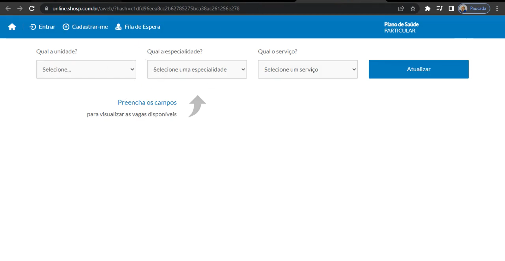
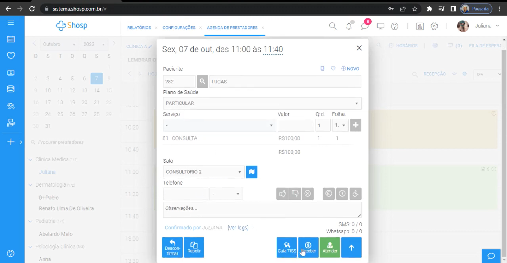
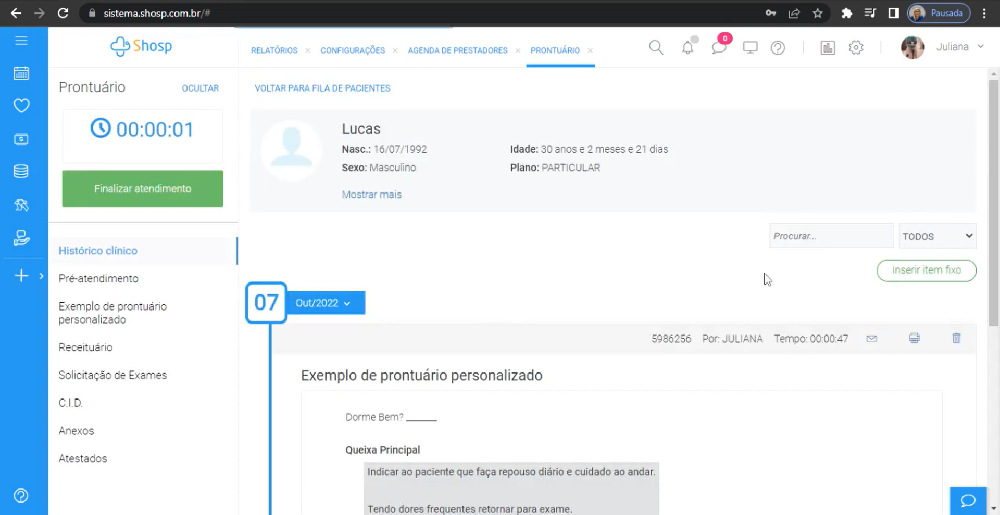
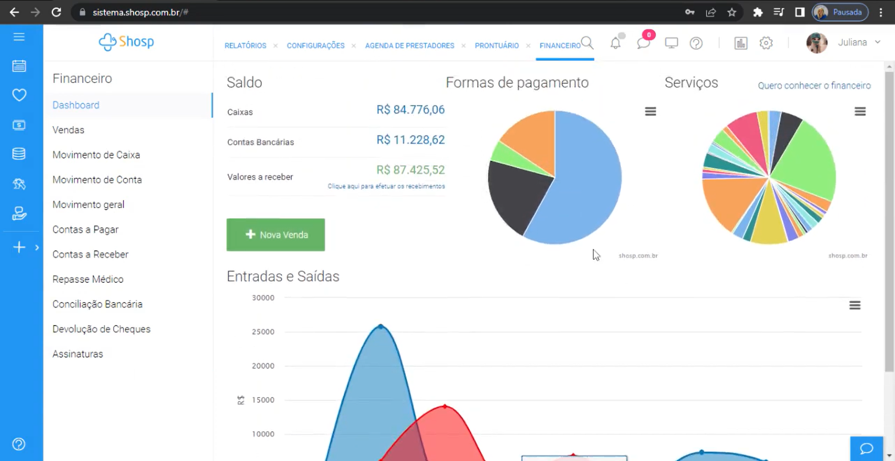
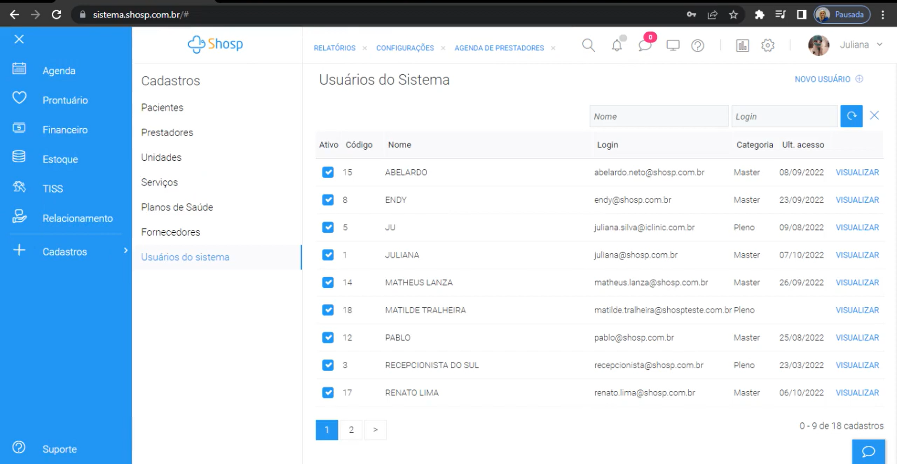
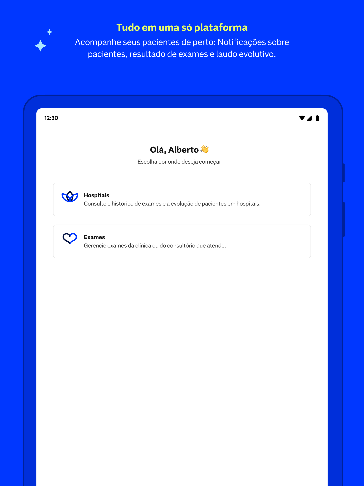
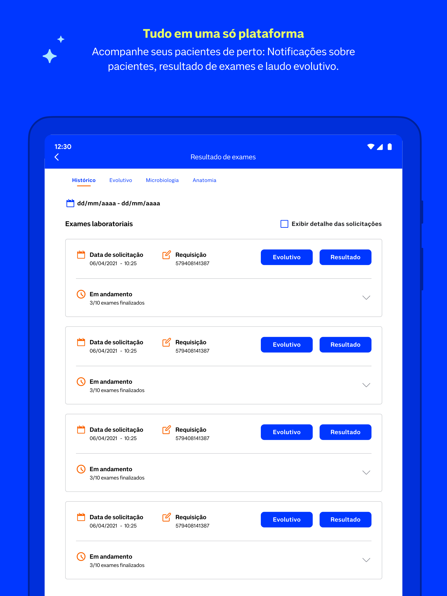
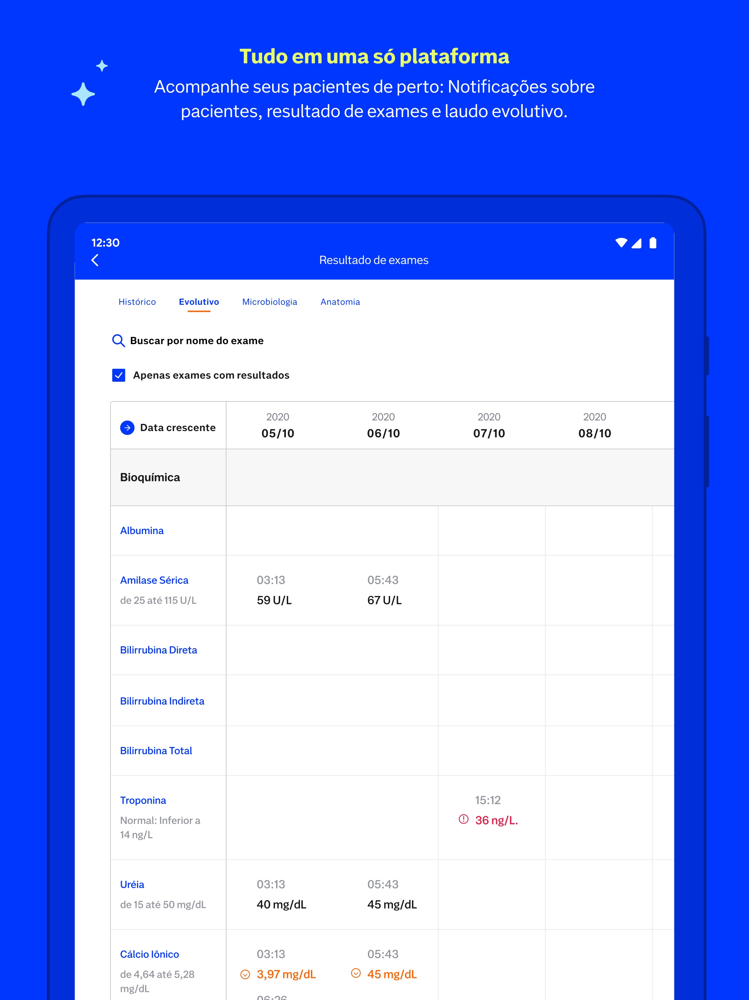

# Entrega 2 — Público-alvo e análise de concorrência

**Data:** 24/10/2026  
**Status:** 🟦 revisada após feedback  
**Responsabilidade mínima:** cada integrante analisa pelo menos 1 concorrente/interface representativa; a equipe produz síntese comparativa.

## Objetivo da atividade

Compreender soluções do mesmo domínio **e também interfaces familiares ao público-alvo**. O objetivo não é copiar telas, mas identificar convenções, padrões, affordances percebidas, problemas recorrentes, expectativas e oportunidades de design.

> **Concorrente não precisa ser idêntico ao produto.** Pode atuar na mesma área, resolver objetivo semelhante ou disputar a mesma necessidade. Quando não houver concorrente direto, use produtos análogos e softwares que o público já utiliza.

### Para TCCs que não previam interface

Não procure apenas um “concorrente do algoritmo”. Investigue **interfaces profissionais que materializam atividades semelhantes** às que o usuário escolhido precisaria realizar.

Exemplos:

- TCC de banco de dados → consoles de administração, ferramentas para DBA, monitoramento e análise de consultas;
- TCC de LLM/ML → painéis de experimentos, gestão de modelos/datasets, comparação de métricas, revisão de resultados;
- TCC de análise de dados → dashboards, ferramentas de BI, filtros, relatórios e exploração;
- TCC de infraestrutura/API → portais administrativos, observabilidade, logs, gestão de credenciais e uso;
- TCC de cibersegurança → consoles de alertas, triagem, histórico e auditoria.

A pergunta é: **“que convenções esse perfil já conhece para executar tarefas equivalentes?”**

## Entrada obrigatória da Entrega 1

Retome o mapa inicial de alternativas e produtos citado na Entrega 1. Aqui a equipe deixa de trabalhar apenas com impressão inicial e passa a **investigar sistematicamente** cada solução.

| Item citado na Entrega 1 | Tipo | Por que foi citado | Status inicial | Decisão nesta entrega |
|---|---|---|---|---|
| Sistemas médicos | ferramenta cotidiana | Não havia citado um produto específico, apenas o uso de ferramentas cotidianas | ? | analisar |

Se uma hipótese da Entrega 1 for confirmada ou refutada durante esta análise, atualize `H01`, `H02`... em [`../RASTREABILIDADE.md`](../RASTREABILIDADE.md).

## 1. Público-alvo desta análise

O perfil prioritário inicial definido na Entrega 1 é o médico nefrologista, cuja adequação ao uso da solução ainda precisa ser validada com profissionais. Shosp e Nav Pro são referências de interfaces usadas pelo público-alvo; sua inclusão não amplia nem redefine esse perfil.

## 2. Concorrentes diretos/indiretos

### Análise C01 — Shosp

**Autor(a):** Mariane S. Carvalho - 22.123.105-3  
**Tipo:** software que o público utiliza  
**Link oficial:** [Shosp](https://www.shosp.com.br/)  
**Data de acesso:** 01/09/2026

#### Contexto e proposta

Segundo a marca, é um software médico completo e intuitivo com todas as funcionalidades necessárias para gerir e otimizar os processos de uma clínica médica.

#### Funcionalidades relevantes

| Funcionalidade | Como é realizada | Evidência/print | Observação de IHC |
|---|---|---|---|
| Login | Através de email e senha, ou via conta Google. |  | A tela apresenta duas formas de autenticação e destaca visualmente a ação principal. O print não permite concluir como o sistema trata falhas de autenticação ou recuperação de conta. |
| Agendamento online | Paciente preenche informações de unidade, especialidade e serviço para visualizar a disponibilidade. |  | O fluxo organiza a seleção de unidade, especialidade e disponibilidade em etapas/campos. O print não mede rapidez nem facilidade de uso. |
| Agendamento | Pessoa responsável pelo agendamento seleciona o profissional, dia e horário desejados, e preenche as informações do paciente. |  | A tela apresenta etapas para profissional, data/horário e dados do paciente, além de campos estruturados. A quantidade de informações torna relevante observar a hierarquia visual; não há evidência de uso que permita afirmar redução de carga cognitiva ou de erros. |
| Prontuário | Usuários conseguem acessar todas as informações referente à um atendimento (receituário, solicitação de exames, atestados, etc.).  |  | O prontuário reúne informações do atendimento e as separa por áreas, como receituário e exames. A tela apresenta vários dados e controles; essa densidade é um aspecto a considerar na análise visual. |
| Financeiro | Usuários têm acesso à informações financeiras (movimentos, contas a pagar/receber, repasses, conciliações bancárias, etc.). |  | A tela organiza informações financeiras em blocos e listas por categoria. A quantidade de conteúdo é observável, mas não permite concluir, por si só, o esforço de interpretação do usuário. |
| Cadastro | Possibilida o gerenciamento de pacientes, prestadores, unidades, serviços, usuários do sistema, etc. |  | A tela apresenta áreas de cadastro para diferentes entidades e usa formulários/listagens. A análise do print não permite afirmar como a validação de campos se comporta em operações reais. |

#### Experiência do usuário e opiniões

1. Depoimento no site do produto:
    - _"A agenda do sistema Shosp ajuda na organização do dia a dia, permitindo uma melhor visão e gestão da clínica. O software médico permite planejar ações de aperfeiçoamento nos meses seguintes baseado nos indicadores de atendimento, faltas e desmarcações."_

2. Avaliações no google:
    - _"O sistema é bom porém o suporte é muito ruim, muitas oscilações e não conseguimos contato horário nenhum. Fora que não tem suporte 24hrs. Parece que estamos a deriva."_
    - _"Sistema instável e suporte inexistente.Trabalhamos com a Shosp há anos, mas atualmente o serviço está péssimo! Hoje 2ª feira muito trabalho para fazer, sao 8:25h e, nada de suporte, nada de ajuda por parte dA Shosp! Um Show de horror! (...)"_
    - _"Não indico para ninguém! Já foi um sistema bom, não sei o que aconteceu mas quase todo dia uma instabilidade no sistema, erros que reportamos e já cheguei a esperar um mês por uma solução, isso não existe! Todo dia tendo que chamar um consultor para reportar algo, é desgastante isso."_

#### Preço/modelo de negócio

Plano mensal por prestador a partir de R$149.

#### Padrões e tendências percebidos

1. Padrões visuais
    - Predominância de azul e branco; esta observação descreve a paleta, sem atribuir a ela efeitos sobre a percepção do usuário.
    - Verde aparece em ações como “Atender”, “Finalizar atendimento” e “Nova Venda”.
    - Ícones são utilizados de forma recorrente para representar funcionalidades.
    - Tipografia simples e interface relativamente limpa.
    - O sistema utiliza diferentes áreas funcionais: agenda, prontuário, financeiro, relatórios etc.
    - As informações são organizadas em painéis, menus laterais, abas e blocos de conteúdo.

2. Padrões de navegação e interação
    Na aplicação administrativa, o menu vertical à esquerda reúne funcionalidades de diferentes módulos. A tela evidencia a navegação disponível, mas não permite medir a rapidez de acesso.

    Na parte superior aparecem abas como:

    >RELATÓRIOS → CONFIGURAÇÕES → AGENDA DE PRESTADORES → PRONTUÁRIO → FINANCEIRO

    As abas apresentam áreas funcionais diferentes no topo da interface.

3. Principais tendências observadas
    - Digitalização do atendimento (agendamento online).
    - Omnichannel (integração com Whatsapp).
    - Data-driven (Dashboards, relatórios e gráficos financeiros).
    - Centralização da gestão (Agenda + prontuário + financeiro + relatórios no mesmo sistema)

#### Pontos positivos, limitações e lições

| Ponto | Evidência | Implicação para nosso projeto |
|---|---|---|
| Organização por módulos |  | O menu e as áreas de cadastro mostram uma divisão por módulos. Sua adoção no projeto depende de identificar tarefas que justifiquem essa navegação. |
| Uso recorrente de cores e ícones |  | A tela registra o uso de cores e ícones; a consistência deve ser avaliada nas telas do próprio projeto, sem presumir efeito sobre a experiência. |
| Densidade de informação |  | O prontuário apresenta informações e controles na mesma tela. Para o projeto, observar a hierarquia entre imagem, identificação do exame e elementos do resultado é uma candidata a princípio de design. |
| Separação de funcionalidades |  | O Shosp separa funcionalidades clínicas e administrativas. Não há, até o momento, tarefas administrativas definidas para a solução de tomografias que justifiquem reproduzir essa estrutura. |

> Repita a subseção para C02, C03... até atender à quantidade da equipe.

## 3. Softwares que o público-alvo usa no cotidiano

Analise interfaces que moldam a expectativa do público, mesmo que não sejam concorrentes.

| Software | Por que o público usa | Padrões relevantes | Prints | O que aprender |
|---|---|---|---|---|
| Nav Pro | Acompanhar e visualizar resultado de exames | A análise registrada identifica telas de início, resultado e evolução, além de uso de ícones, categorias e abas. “Simples” e “intuitiva” não são conclusões de teste com usuários. |    | Observar como as telas e categorias se relacionam com a consulta de resultados. Validar com o público-alvo quais informações e termos são adequados ao fluxo de tomografia renal. |

## 3.1 Padrões de interface relevantes ao escopo de IHC

Registre somente padrões encontrados nas soluções analisadas e que possam ter relação com objetivos reais da equipe.

| Padrão observado | Produto(s) | Para qual tarefa serve | Vantagem percebida | Risco/limitação | Situação no escopo |
|---|---|---|---|---|---|
| dashboard | - | - | - | - | não |
| relatório | - | - | - | - | não |
| histórico + filtros | Shosp, Nav Pro | Possível consulta de exames anteriores; a tarefa ainda precisa ser confirmada para o recorte de tomografia renal | As interfaces analisadas registram esse padrão; a análise não comprova que ele seja necessário na solução | Não há necessidade confirmada de armazenar, localizar ou comparar exames anteriores no fluxo do projeto. | padrão observado; hipótese a validar |
| administração/CRUD | Shosp | Possível manutenção de dados administrativos; nenhuma tarefa desse tipo foi identificada para o fluxo principal | A análise do Shosp registra áreas de cadastro; não há evidência registrada de CRUD no Nav Pro | A Entrega 1 não definiu perfis, papéis ou tarefas administrativas para a solução. | padrão observado; não adotar sem tarefa confirmada |
| comparação de resultados | - | - | - | - | não |

> O objetivo não é concluir “todo concorrente tem dashboard, então teremos um”. O padrão só será adotado se apoiar uma tarefa rastreável.

## 4. Síntese comparativa da equipe

| Critério | C01 — Shosp | C02 — Nav Pro (referência cotidiana) | C03 — não analisado | Oportunidade para o projeto |
|---|---|---|---|---|
| Navegação | O Shosp usa menu lateral e abas para suas áreas administrativas, como agenda, prontuário e financeiro. | A análise do Nav Pro registra telas de início, resultado e evolução, e descreve navegação por abas e categorias; não há medida de eficiência de navegação. | Não há terceiro produto analisado nesta entrega. | Mapear primeiro as tarefas do fluxo de exame; manter menu lateral, atalhos ou módulos como hipótese até que a quantidade de destinos seja conhecida. |
| Feedback/estado | O Shosp usa cores e ícones em ações. As avaliações citadas mencionam instabilidade do serviço e suporte, não a qualidade do feedback da interface. | As telas do Nav Pro descritas como início, resultado e evolução não têm mensagens de erro ou estados de processamento documentados na análise. | Não há terceiro produto analisado nesta entrega. | Investigar mensagens e estados para recebimento, processamento, falha e disponibilidade do resultado no fluxo do projeto; não tratar reclamações de disponibilidade como evidência de falha de interface. |
| Prevenção/recuperação de erro | O Shosp apresenta campos estruturados e etapas em fluxos de agendamento; a análise não documenta comportamento de erro nesses fluxos. | Não há comportamento de erro documentado nas telas do Nav Pro descritas. | Não há terceiro produto analisado nesta entrega. | Investigar validação e recuperação nas tarefas reais de fornecimento do exame e consulta do resultado; não assumir que os fluxos do Shosp se aplicam. |
| Terminologia | A análise do Shosp registra termos clínicos e administrativos; para o Nav Pro, foram registrados “resultado” e “evolução”. | Os termos observados não comprovam adequação ao fluxo de interpretação de tomografias renais. | Não há terceiro produto analisado nesta entrega. | Validar com médicos os termos para classificação, confiança, explicação e conclusão profissional (H04 e H06). |
| Acessibilidade/hierarquia | O prontuário e o financeiro do Shosp apresentam vários dados e controles; não foi realizada avaliação de acessibilidade. | A análise registra separação por categorias e informações relevantes, sem avaliar contraste, legibilidade ou uso assistivo. | Não há terceiro produto analisado nesta entrega. | Considerar hierarquia e densidade ao apresentar imagem, identificação do exame e resultado; avaliar acessibilidade nas telas do projeto. |
| Eficiência | As telas do Shosp mostram módulos e etapas, mas não há observação ou medida de desempenho de usuários. | Abas e categorias são registradas na análise; não há observação ou medida de desempenho de usuários. | Não há terceiro produto analisado nesta entrega. | Investigar o fluxo com usuários antes de definir atalhos, filtros ou otimizações para tarefas recorrentes. |

## 5. Recomendações derivadas

- **RC01 — hipótese a validar:** O Shosp apresenta menu lateral e múltiplos módulos (C01, cadastro e navegação administrativa). O fluxo proposto para o projeto é fornecer o exame, acompanhar o processamento e consultar o resultado; ainda não há tarefas que demonstrem a necessidade de vários módulos ou de um menu lateral. Definir a arquitetura de navegação após mapear esse fluxo.
- **RC02 — investigar no fluxo do projeto:** Os prints do Shosp registram telas de autenticação e formulários, mas não documentam falhas e recuperação; as avaliações citadas tratam de instabilidade do serviço e suporte, não de mensagens da interface. Como o fluxo proposto envolve fornecimento do exame e processamento, investigar mensagens explícitas de erro, confirmação e recuperação nessas tarefas, sem atribuir essa recomendação às avaliações de disponibilidade.
- **RC03 — investigar com usuários:** O Shosp apresenta vocabulário clínico e administrativo, e a descrição do Nav Pro registra “resultado” e “evolução”. Essas evidências não confirmam a adequação dos termos ao fluxo de interpretação renal. Validar com médicos a linguagem para classificação, confiança, explicação e conclusão profissional (H04 e H06).
- **RC04 — candidata a princípio de design:** A tela de prontuário do Shosp concentra informações e controles (C01, print 04). No fluxo proposto, imagem, identificação do exame e elementos do resultado podem disputar atenção; ao projetar essas telas, avaliar densidade e hierarquia visual sem presumir que os dados devam ficar simultaneamente visíveis.
- **RC05 — padrão observado, necessidade a validar:** A análise registra histórico/filtros em Shosp e Nav Pro (seção 3.1), mas isso não comprova que o usuário precise buscar ou comparar exames anteriores na solução. Investigar essa tarefa antes de especificar filtros ou histórico.
- **RC06 — hipótese a investigar:** O fluxo proposto inclui acompanhar o processamento do exame, mas a análise das interfaces não documenta um padrão específico de status do Nav Pro ou mensagens de processamento no Shosp. Investigar quais estados e ações precisam ser apresentados (por exemplo, exame recebido, processamento, falha ou resultado disponível) antes de decidir por uma visão resumida.
- **RC07 — hipótese a validar:** O Shosp apresenta funcionalidades administrativas e de configuração (C01), mas a Entrega 1 não identificou tarefas administrativas necessárias à solução de análise de tomografias. Não separar módulos de operação e configuração até confirmar que essas tarefas existem.

## Referências

- Shosp: [Shosp](https://www.shosp.com.br/)
- Avaliações Shosp: [Google Shosp](https://www.google.com/search?q=shosp&sca_esv=97ecd86c81018411&rlz=1C1CHZN_enBR988BR988&sxsrf=APpeQnseGP1NEU5eJ3qKMBPHZanrb9ZEQw%3A1788802583374&ei=F_aeasaxFv7e1sQP5fbC0Qw&biw=1280&bih=593&ved=2ahUKEwiGmbj0gN2WAxV-r5UCHWW7MMoQ4dUDegQIBhAM&uact=5&oq=shosp&gs_lp=Egxnd3Mtd2l6LXNlcnAiBXNob3NwMgQQIxgnMgQQIxgnMgQQIxgnMgoQABiABBgUGIcCMgUQABiABDIFEAAYgAQyChAAGIAEGIoFGEMyBRAAGIAEMgUQABiABDIFEAAYgARIuARQuAJYuAJwAXgBkAEAmAGTAaABkwGqAQMwLjG4AQPIAQD4AQGYAgKgAp8BwgIKEAAYRxjWBBiwA8ICFxAuGNwGGLgGGNoGGNgCGMgDGLAD2AEBmAMAiAYBkAYIugYECAEYGZIHAzEuMaAH5AayBwMwLjG4B5sBwgcFMC4xLjHIBwmACAE&sclient=gws-wiz-serp#lrd=0x935ef15e596c7a0f:0xe97675e9eadc0a5f,1,,,,)
- Conheça o Sistema Shosp: [Demo](https://www.youtube.com/watch?v=o45d1eBKSM8)
- Nav Pro: [Nav Pro](https://navpro.dasa.com.br/)
- Nav Pro Google Play: [App Nav Pro](https://play.google.com/store/apps/details?id=br.com.dasa.hospitais.patientmonitor&hl=pt_BR)

## Checklist

- [x] O mapa inicial de alternativas da Entrega 1 foi revisitado e aprofundado.
- [x] Hipóteses relevantes sobre mercado/padrões foram atualizadas na rastreabilidade quando surgiram evidências.
- [x] Há pelo menos uma análise completa por integrante.
- [x] Cada análise contém prints legíveis da interface.
- [x] Prints mostram telas/estados relevantes, não apenas logos/homepage.
- [x] Foram analisados concorrentes e/ou interfaces representativas ao público.
- [ ] Em TCC sem interface original, foram investigadas ferramentas profissionais análogas às atividades do usuário escolhido.
- [x] Padrões como dashboard, relatório, filtros e CRUD foram analisados como soluções para tarefas, não como requisitos automáticos.
- [x] Opiniões de UX têm fonte.
- [x] A síntese compara Shosp e Nav Pro em critérios comuns e explicita limites das evidências disponíveis.
- [x] Recomendações distinguem candidatas e hipóteses de decisões já validadas; padrões administrativos do Shosp não são tratados como requisitos automáticos.
