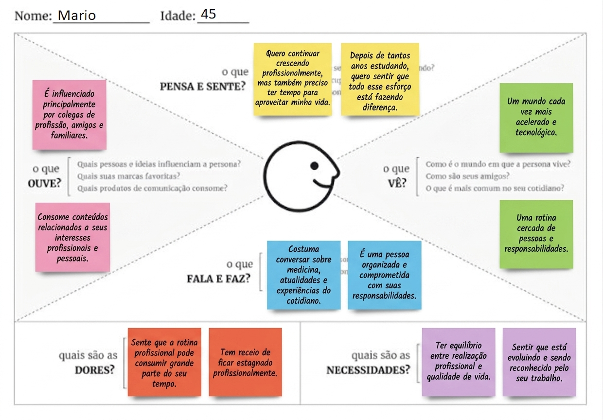

# Entrega 3 - Personas, mapa de empatia, contexto de uso e jornada

**Data:** 24/10/2026  
**Status:** 🟦 revisada após feedback  
**Responsabilidade:** 1 persona por integrante; 1 mapa de empatia, 1 contexto de uso consolidado e 1 jornada por equipe (salvo orientação diferente do docente).

## Objetivo da atividade

Representar grupos de usuários de forma útil para decisões de design. Persona não é personagem decorativo: suas características devem alterar requisitos, prioridades, linguagem, fluxos ou critérios de avaliação.

## Atenção a projetos técnicos

Em TCCs sem interface original, a persona pode representar um **profissional que se apropria da contribuição técnica**: DBA, analista, cientista de dados, administrador, pesquisador, técnico, operador, gestor ou especialista de domínio.

Não escolha um perfil apenas porque “parece combinar” com a tecnologia. Explique **qual objetivo esse perfil teria e qual parte da contribuição do TCC produziria valor para ele**. Se ainda for hipótese, mantenha como hipótese/proto-persona a validar.

Também considere papéis diferentes quando houver tarefas distintas, por exemplo:

- operador que executa análises;
- administrador que configura e gerencia permissões;
- especialista que interpreta resultados;
- gestor que consulta relatórios e decide;
- auditor que revisa histórico.

## Entradas da Entrega 1

Antes de criar personas, retome os tipos de usuários, características relevantes, objetivos e hipóteses registradas na Entrega 1. A persona **não deve transformar uma hipótese inicial em fato por meio de uma história fictícia**.

| Item da Entrega 1 | Status inicial | Evidência disponível agora | Como será tratado nesta entrega |
|---|---|---|---|
| Usuário direto/beneficiário | H | A Entrega 1 registra perfis potenciais e escolhe inicialmente o nefrologista; o uso direto e a adequação do perfil precisam ser validados. O objetivo técnico declarado pelo TCC não comprova adoção clínica. | Manter P01 como proto-persona do recorte provisório, sem tratar o perfil como usuário confirmado. |
| Objetivo principal do usuário | H | A Entrega 1, seção 7.3, propõe avaliar tomografias e considerar a indicação do modelo; a própria entrega marca a atividade e o benefício como não validados com profissionais. | Usar como objetivo provisório para orientar perguntas e tarefas futuras, não como fato sobre usuários. |
| Característica relevante: conhecimento clínico e baixa familiaridade com ML | H / [?] | H04 propõe familiaridade com sistemas de visualização e possível desconhecimento de métricas de ML; experiência, vocabulário e necessidades ainda não foram levantados. | Manter como hipótese e investigar antes de definir linguagem ou detalhe da interface. |
| H01 - explicação do modelo pode ser compreensível e útil | H | H01 pergunta se médicos nefrologistas compreenderão e considerarão útil a explicação; compreensão, utilidade, confiança e adoção não foram observadas nem demonstradas. | Manter como hipótese, sem presumir que explicabilidade produza confiança ou uso. |
| H02 - fluxo de fornecimento do exame, processamento e resultado | H | A Entrega 1 propõe esse recorte, mas quem fornece/acessa o exame, o meio de entrada e a relevância do fluxo no trabalho real permanecem desconhecidos. Frequência e criticidade não foram confirmadas. | Apresentar a jornada como provisória e investigar o fluxo antes de consolidá-lo. |
| H03 - médico distingue a indicação da IA do diagnóstico final | H | H03 registra essa distinção como hipótese; entendimento, responsabilidades e possíveis consequências precisam ser investigados com profissionais. | Investigar antes de definir mensagens, governança ou requisitos de interface. |

## 1. Personas

### Persona P01 - Mário Russano

**Autor(a):** Mariane S. Carvalho  
**Tipo:** primária 
**Base de evidências:** proto-persona a validar; nenhum dado de entrevista ou observação de usuários está registrado nesta entrega. O tema e a contribuição técnica do TCC são declarações documentadas; as características pessoais e profissionais abaixo permanecem hipóteses.
**Hipóteses da Entrega 1 relacionadas:** H02

| Campo | Descrição |
|---|---|
| Faixa etária / contexto relevante | [H] A idade fictícia de 45 anos e a rotina clínica intensa são elementos narrativos, sem evidência de usuários consultados. |
| Ocupação/papel | [H] Médico nefrologista é o perfil priorizado inicialmente pela equipe na Entrega 1, seção 7.2; o uso direto da solução por esse perfil ainda precisa ser validado. |
| Conhecimento do domínio | [H] Conhecimento especializado em nefrologia e interpretação de tomografias, bem como a relação dessa atividade com o fluxo proposto, precisam ser investigados com profissionais. |
| Experiência tecnológica | [H] Familiaridade com sistemas clínicos e conhecimento de IA/ML não foram levantados; não se presume uso diário de sistemas nem nível de experiência. |
| Objetivos | [H] Avaliar possíveis achados em tomografias e considerar a indicação do modelo ao decidir como prosseguir é o objetivo proposto pela equipe (Entrega 1, seção 7.3), ainda não validado com usuários. |
| Necessidades | [H] Clareza, visualização da imagem e compreensão da explicação são necessidades a investigar (H01, H06); não se presume que todas sejam necessárias ou atendidas pelo modelo. |
| Dores/frustrações | [H] Pressão de tempo e possível dificuldade para identificar alterações sutis são hipóteses pendentes (H05). [?] Volume de exames, interrupções e frustração com sistemas não foram observados nem relatados por usuários. |
| Motivadores | [H] Benefícios como apoiar a avaliação e compreender a indicação do modelo são esperados pela equipe a partir do objetivo do TCC; impacto na prática clínica não foi demonstrado. |
| Restrições/acessibilidade | [?] Tempo de aprendizagem, carga cognitiva, dispositivos, monitores e necessidades de acessibilidade do público não foram investigados. |
| Ambiente típico de uso | [?] Instituição, local, equipamentos, presença de outras pessoas, interrupções e condições de uso permanecem desconhecidos; ver investigação do contexto na seção 3. |
| Comportamentos relevantes | [H] Comparar a indicação do modelo com a própria avaliação é uma hipótese ligada a H01–H03, não um comportamento observado. |

**Direções provisórias de design a validar com P01:**

- [H] Investigar quais elementos da classificação e da explicação são compreendidos e úteis antes de definir como apresentá-los (H01, H06).
- [H] Verificar se comparar a imagem e a indicação do modelo faz parte da tarefa; não presumir que o modelo produza uma visualização de regiões relevantes (H01, H06).
- [H] Investigar como distinguir a indicação do modelo de uma conclusão clínica (H03).
- [?] Não especificar indicador de confiança, quantidade de etapas, histórico, dashboard ou requisito de rapidez antes de confirmar a necessidade e a capacidade técnica correspondente (H02, H06, H07).

> Repita para P02, P03... Cada integrante deve produzir ao menos uma persona.

### Síntese das personas

P01 é a persona primária do recorte de IHC definido pela equipe: o objetivo proposto é que um médico nefrologista considere a classificação de tomografias renais ao avaliar possíveis achados e decidir como prosseguir (Entrega 1, seções 7.2–7.3). Essa escolha relaciona o perfil ao objetivo e à tarefa central do exercício; não comprova que nefrologistas usem diretamente a solução nem que essa tarefa corresponda ao fluxo real. A adequação do perfil e sua relação com outros papéis permanecem por validar com profissionais (H02, H03).

## 2. Mapa de empatia - equipe

**Persona escolhida:** P01  
**Justificativa:** P01 representa o perfil escolhido para investigar o objetivo e a tarefa propostos na seção “Síntese das personas”. A primazia é uma decisão provisória de escopo, não uma conclusão sobre o fluxo clínico real.

O mapa foi refeito para relacionar as dimensões à tarefa de avaliar tomografias e considerar a indicação do modelo. Não há relatos de usuários nesta entrega; por isso, as hipóteses são identificadas como `[H]` e as informações desconhecidas como `[?]`. As perguntas no mapa orientam investigação e não são falas ou comportamentos atribuídos a Mário.

| Dimensão | Registro provisório | Estado e origem |
|---|---|---|
| O que vê | Pode consultar uma tomografia e uma classificação produzida por modelo no recorte proposto. Quais imagens, metadados e elementos do resultado estão disponíveis na prática? | [H] A contribuição técnica declarada classifica imagens de tomografias renais (Entrega 1, seções 0.2 e 1.3); a forma de uso está pendente (H02, H06). |
| O que ouve | Que profissionais participam do encaminhamento, interpretação ou discussão do exame? O que comunicam entre si? | [?] Papéis, comunicações e colaboração reais não foram levantados. |
| O que fala e faz | Como seleciona/recebe o exame, avalia achados, consulta outras informações e decide como prosseguir? O que faz quando a indicação automatizada diverge de sua avaliação? | [?] A atividade e o fluxo ainda não foram observados; considerar H02 e H03 como questões de pesquisa. |
| O que pensa e sente | A explicação do modelo é compreensível e relevante? A indicação corresponde ao que observa na imagem? | [H] Questões derivadas de H01 e H03; não representam pensamentos ou emoções observados. |
| Dores | Que dificuldades, interrupções, riscos de confusão ou retrabalho surgem durante a atividade? | [?] Não há evidência sobre dores reais; pressão de tempo e dificuldades permanecem hipóteses em H05. |
| Ganhos esperados | Que resultado positivo a pessoa espera obter após considerar a informação do modelo? | [H] A equipe propõe apoio à avaliação clínica como benefício esperado (Entrega 1, seção 1.5); ganho percebido e efeito na atividade não foram demonstrados. |
| Necessidades a investigar | Quais informações ajudariam a compreender a indicação sem confundi-la com conclusão clínica? A explicação ou uma medida de confiança seria útil e compreensível? | [H] Questões associadas a H01, H03 e H06; não são requisitos confirmados. |

## 3. Contexto de uso - consolidação

| Dimensão | Descrição e estado do conhecimento | Implicação de design / investigação |
|---|---|---|
| Usuários e tarefas | [H] O perfil inicialmente escolhido é o médico nefrologista (Entrega 1, seção 7.2). O objetivo proposto é avaliar a tomografia e considerar a indicação do modelo (seção 7.3); uso direto, tarefas e participação de radiologistas ou outros profissionais não foram validados (H02). | Confirmar quem recebe/fornece o exame, quem o interpreta e quem consulta a saída. Não definir permissões ou interfaces para outros perfis sem tarefa confirmada. |
| Equipamentos e sistemas | [?] Dispositivo, monitor, software de visualização, documentos e sistemas usados simultaneamente não foram identificados. | Investigar equipamentos e alternância entre ferramentas antes de decidir resolução, zoom, integração ou transferência de dados. |
| Ambiente físico | [?] Local de trabalho, privacidade, condições de visualização, interrupções e restrições de tempo são desconhecidos; alta demanda e pressão de tempo são hipóteses (H05). | Investigar condições reais e como elas afetam leitura, privacidade e retomada da tarefa; somente então definir requisitos ambientais. |
| Ambiente social/organizacional | [?] Presença de colegas, colaboração, comunicação, regras institucionais e condições de compartilhamento não foram levantadas. | Identificar participantes e regras do fluxo antes de propor compartilhamento, registro ou acesso por múltiplos perfis. |
| Papéis e governança | [H] A equipe propõe que a indicação do modelo seja considerada como apoio, sem equivaler à conclusão clínica (Entrega 1, seção 1.5; H03). Responsabilidades e governança reais não foram investigadas. | Verificar como a saída deve ser comunicada e diferenciada de uma decisão clínica; não presumir responsabilidades ou permissões além do escopo documentado. |
| Volume de dados e histórico | [?] Quantidade de exames e necessidade de recuperar análises anteriores, buscar ou filtrar não foram confirmadas; a necessidade de histórico permanece hipótese (H07). | Não especificar histórico, busca ou filtros como requisito até validar a tarefa e seu contexto. |

## 4. Jornada do usuário - equipe

**Persona:** P01  
**Objetivo da jornada:** Explorar, provisoriamente, como o perfil escolhido poderia considerar a classificação de uma tomografia renal ao avaliar possíveis achados. A necessidade, a forma de entrada do exame e o papel da explicação ainda dependem de validação (H01, H02, H06).
**Início e fim da jornada:** Começa com a necessidade proposta de avaliar uma tomografia e inclui uma etapa pós-interface para investigar o que acontece após a consulta ao resultado. O fluxo descrito é uma hipótese baseada em H02, não uma jornada observada; ações clínicas posteriores permanecem desconhecidas.

| Etapa | Situação/ação | Objetivo | Pensamento/emoção | Dor | Oportunidade de design | Evidência |
|---|---|---|---|---|---|---|
| 1 - Necessidade de avaliar | [H] O recorte propõe que o perfil priorizado precise avaliar uma tomografia renal. | Identificar o exame relacionado à atividade. | [H] Como essa necessidade surge no fluxo real? | [?] Origem, encaminhamento e contexto do exame são desconhecidos. | Investigar o início real da atividade e os participantes. | [H] objetivo proposto na Entrega 1, seção 7.3; fluxo a validar (H02). |
| 2 - Acesso ao exame | [H] O fluxo pode envolver receber, acessar ou selecionar um exame; não se assume envio manual. | Ter acesso ao exame que será avaliado. | [?] Quem fornece o exame e por qual sistema ou meio? | [?] Etapa e possíveis erros não foram observados. | Investigar origem, formato, identificação e transferência do exame. | [H] fluxo de fornecimento pendente (H02); detalhes desconhecidos. |
| 3 - Processamento | [H] No recorte proposto, o modelo classifica imagens de tomografias renais. | Obter a saída técnica produzida pelo modelo. | [?] Como a análise é iniciada e quanto tempo leva? | [?] Espera, falhas e interrupções não foram investigadas. | Verificar o fluxo real e se o estado do processamento precisa ser comunicado. | [F] classificação de imagens renais é capacidade declarada (Entrega 1, seções 0.4 e 1.3); interação e tempo não definidos (H02). |
| 4 - Consulta à saída | [H] O resultado proposto inclui uma classificação; demais elementos dependem do modelo e da investigação. | Compreender o que foi produzido, sem presumir significado clínico. | [?] Que informação é apresentada e como é interpretada? | [?] Compreensão e utilidade não foram avaliadas. | Investigar quais elementos e explicações são necessários; não presumir indicador de confiança. | [F] modelo classificador declarado na Entrega 1, seções 0.4 e 1.3; apresentação e compreensão pendentes (H01, H06). |
| 5 - Examinar a explicação | [H] P01 poderia consultar uma explicação associada à classificação, caso ela seja produzida e útil. | Investigar o que a explicação permite compreender. | [?] Que tipo de explicação é compreensível e relevante? | [?] Não se sabe se a explicação ajuda, não altera ou dificulta a interpretação. | Validar método, apresentação e compreensão; não tratar explicabilidade como confiança. | [H] H01 e H06; utilidade e forma da explicação não demonstradas. |
| 6 - Relacionar à avaliação | [H] O recorte propõe considerar a indicação junto à tomografia e à avaliação profissional. | Investigar se e como a indicação é comparada com outras informações. | [?] O que ocorre quando a indicação diverge da avaliação? | [?] Divergências e estratégias de resolução não foram observadas. | Investigar a tarefa antes de definir comparação lado a lado ou outro recurso. | [H] hipótese associada a H01 e H03; atividade real a validar. |
| 7 - Decidir como prosseguir | [H] A equipe propõe a indicação como informação de apoio, não como conclusão clínica. | Descobrir se a informação influencia uma decisão ou ação posterior. | [?] O profissional usa, ignora ou encaminha a indicação? | [?] Consequências e responsabilidades no fluxo real são desconhecidas. | Distinguir a saída do modelo da decisão clínica, conforme validação de H03. | [F] intenção de apoio declarada na Entrega 1, seção 1.5; uso e efeito não demonstrados (H03). |
| 8 - Encerrar a consulta à interface | [?] Não foi definido se o resultado é registrado, exportado, comunicado ou recuperado depois. | Identificar o que encerra o uso da interface. | [?] O que precisa ser preservado e por quem? | [?] Necessidade de histórico ou registro não confirmada (H07). | Investigar destino da informação antes de projetar histórico, exportação ou compartilhamento. | [?] Lacuna; H07 pendente. |
| 9 - Pós-uso: atividade subsequente | [?] O que o profissional faz no mundo real após consultar ou não a saída do modelo ainda não é conhecido. | Identificar eventual comunicação, registro, revisão ou próximo passo clínico e o benefício obtido. | [?] A informação altera a atividade seguinte? | [?] Não há evidência sobre ações ou resultados após o uso. | Entrevistar/observar participantes do fluxo; só então representar consequências e requisitos de pós-uso. | [?] Lacuna de investigação; não atribuir uma ação ou benefício sem evidência. |

> A jornada pode incluir etapas **antes, durante e depois** do uso do produto. Não transforme a jornada em lista de telas.

## Síntese

Os cenários e tarefas seguintes devem preservar, como **proposta a validar**, o objetivo de avaliar uma tomografia renal e considerar a classificação do modelo para decidir como prosseguir com a avaliação (P01; Entrega 1, seção 7.3; H02). Devem investigar quem fornece/acessa o exame e por qual fluxo (H02), quais elementos da saída e da explicação são compreensíveis e úteis (H01, H06), como distinguir indicação automatizada de decisão clínica (H03) e o que ocorre após a consulta à interface, incluindo eventual comunicação, registro ou ação subsequente. Não tratar como fatos a rotina clínica, o upload manual, a pressão de tempo, a necessidade de histórico, as emoções atribuídas à persona ou qualquer benefício clínico.

## Checklist

- [x] Existe pelo menos uma persona por integrante.
- [x] As personas não são apenas diferenças demográficas superficiais.
- [x] Está claro o que é dado real e o que é hipótese/proto-persona.
- [x] A persona não “validou por ficção” uma hipótese da Entrega 1; afirmações continuam marcadas como hipótese quando não há evidência.
- [x] Objetivos e dores têm consequência para o design.
- [x] Contexto de uso está coerente com a Entrega 1.
- [ ] Em TCC sem interface original, a persona possui relação explícita com a contribuição técnica.
- [x] Papéis administrativos, técnicos e decisórios só foram criados quando possuem objetivos/tarefas diferentes.
- [x] Jornada possui etapas, dores e oportunidades e não é apenas wireflow.
- [x] IDs das personas foram adicionados à rastreabilidade.
