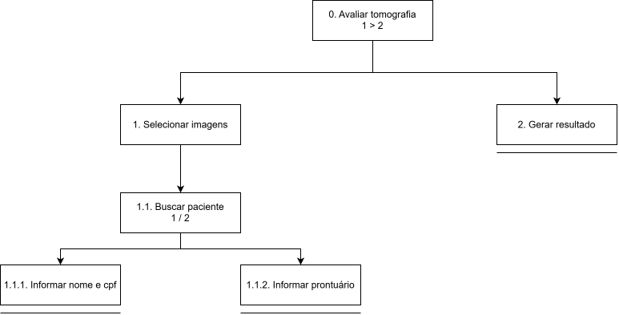
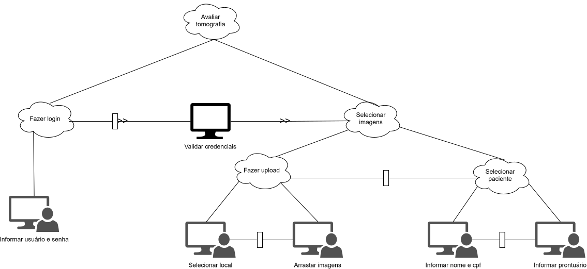

# Entrega 5 — Análise de tarefas: HTA, GOMS e CTT

**Data:** 07/11/2026  
**Status:** 🟩 concluída  
**Responsabilidade:** cada integrante modela pelo menos 1 HTA, 1 GOMS e 1 CTT. As três técnicas podem abordar a mesma funcionalidade ou funcionalidades distintas, conforme a orientação da disciplina.

## Objetivo da atividade

Modelar tarefas importantes sob perspectivas complementares: decomposição hierárquica (HTA), estrutura de metas/métodos/operações (GOMS) e relações temporais entre tarefas (CTT). O diagrama deve ser acompanhado de interpretação textual.

## Para projetos cujo TCC não previa interface

Modele **tarefas humanas relacionadas ao uso da contribuição técnica**, e não a implementação interna do algoritmo. Exemplos de boas tarefas para análise:

- investigar uma consulta de baixo desempenho;
- configurar uma análise e selecionar parâmetros;
- submeter um dataset e verificar sua validade;
- acompanhar uma execução demorada;
- comparar dois resultados/modelos;
- interpretar uma recomendação e decidir se a aceita;
- localizar uma execução anterior usando busca/filtros;
- gerar e compartilhar um relatório;
- administrar papéis/permissões quando isso for parte do trabalho real;
- revisar um alerta e registrar uma decisão.

Um CRUD pode gerar tarefas relevantes, mas “cadastrar usuário” só merece modelagem se tiver significado no domínio (papéis, validações, riscos, permissões, dependências).

## Seleção das tarefas

| ID | Tarefa | Persona/cenário de origem | Frequência/criticidade | Autor responsável |
|---|---|---|---|---|
| T01 | Avaliar tomografia | P01/C01 | Alta frequência / Alta criticidade | Mariane S. Carvalho - RA: 22.123.105-3 |

> Priorize tarefas necessárias para que o usuário alcance objetivos centrais. Não desperdice a modelagem em ações triviais isoladas, como “clicar em login”, se o objetivo relevante é maior. Da mesma forma, não modele o funcionamento interno do algoritmo como se fosse uma tarefa humana.

---

## HTA — T01 Avaliar tomografia

**Autor(a):** Mariane S. Carvalho - RA: 22.123.105-3

### Descrição da tarefa

O objetivo é avaliar uma tomografia renal e decidir como prosseguir diante de possíveis achados. A tarefa começa quando o Mario Russano precisa examinar o caso em uma clínica de nefrologia e tem acesso às imagens e às informações clínicas disponíveis; termina após revisar o exame, considerar possíveis achados e definir se é necessária alguma avaliação complementar. O cenário e o fluxo de acesso às imagens são hipóteses ainda não validadas com profissionais. No diagrama atual, a decomposição chega apenas à seleção das imagens e ainda não representa sua avaliação nem a decisão final, que é feita unicamente por Mario.

### Diagrama

### Decomposição e planos

| ID | Objetivo/operação | Plano/ordem | Problema ou decisão de design observada |
|---|---|---|---|
| 0. | Avaliar tomografia 1 > 2 | Selecionar imagens **E DEPOIS** Gerar resultado | A decomposição ainda não representa a análise das imagens, a consideração da indicação do modelo nem a decisão de como prosseguir; login como pré-requisito também é uma hipótese a validar. |
| 1. | Selecionar imagens | Selecionar paciente | As alternativas precisam levar ao exame correto; validar se o fluxo real permite envio de arquivos, busca de paciente ou ambos. |
| 1.1. | Selecionar paciente 1 / 2 | Informar nome e cpf **OU** informar prontuário | A busca deve permitir localizar e confirmar o paciente correto sem expor dados pessoais desnecessariamente; validar os identificadores usados no fluxo real. |
| 1.1.1. | Informar nome e cpf |  | Nome e CPF são dados pessoais; apresentar resultados de modo que o profissional confirme a identidade sem ambiguidade. |
| 1.1.2. | Informar prontuário |  | Orientar o formato do identificador e informar claramente quando não houver correspondência ou houver mais de uma. |
| 2. | Gerar resultado |  | Informar que o resultado gerado é complementar e não substitui a avaliação médica. |

**Verificação do HTA:**

- O objetivo 0 representa uma meta do usuário?
- As subtarefas são necessárias e suficientes?
- Os **planos** indicam ordem, alternativa, repetição ou condição?
- A decomposição parou em nível útil para projeto de interação?

---

## GOMS — T01 Avaliar tomografia

**Autor(a):** Mariane S. Carvalho — RA: 22.123.105-3

### Goal

`G0: Buscar paciente`

### Métodos, operadores e regras de seleção

- **Method M1:** Informar nome ou CPF
  - Operators: 
    - OP1: Clicar no campo de busca.
    - OP2: Digitar nome ou CPF do paciente.
    - OP3: Selecionar o paciente desejado.
    - OP4: Confirmar a identificação do paciente.
- **Method M2:** Informar prontuário
  - Operators: 
    - OP1: Clicar no campo de busca.
    - OP2: Digitar número do prontuário.
    - OP3: Selecionar o paciente desejado.
    - OP4: Confirmar a identificação do paciente.
- **Selection Rule SR1:** usar M1 quando preferência do usuário informar nome ou CPF; usar M2 quando preferência do usuário for informar número de prontuário.

> Não chame qualquer passo de “método”. Em GOMS, métodos são sequências alternativas capazes de atingir uma meta; regras de seleção explicam quando escolher entre eles.

---

## CTT — T01 Avaliar tomografia

**Autor(a):** Mariane S. Carvalho — RA: 22.123.105-3

### Descrição

O diagrama representa uma proposta de fluxo em que Mario Russano seleciona um paciente, informando nome/CPF ou número de prontuário. Após selecionar o paciente, as imagens passam pelo modelo que gera um resultado, e Mario interpreta sua avaliação. Assim, a tarefa começa com a escolha do paciente e termina com a interpretação desse resultado; o diagrama não detalha a inspeção das imagens nem como o profissional decide os próximos passos clínicos. O fluxo, as alternativas e o papel do resultado são propostas ainda a validar com profissionais.

### Diagrama

### Legenda e relações temporais usadas

| Operador/relação | Significado no diagrama | Exemplo no modelo |
|---|---|---|
| `[]>>` — ativação com passagem de informação | A segunda tarefa ocorre somente após a primeira, e a informação da primeira tarefa é passada para a segunda | Mário Russano faz seleciona um paciente, e só após o modelo é acionado para predição, utilizando as imagens deste paciente. |
| `[]` — escolha | Duas opções habilitadas para alcançar a mesma meta, mas uma vez que uma é escolhida, a outra é desabilitada. | Mario Russano escolhe o conjunto de um paciente específico a partir de uma busca por nome e cpf deste paciente. |

Identifique, quando aplicável, tarefas de usuário, sistema, interação e tarefas abstratas. Verifique se concorrência, escolha, habilitação, desabilitação e repetição estão representadas corretamente segundo a notação adotada em aula.

---

## Síntese da equipe

Como oportunidades de interação a investigar, destacam-se a forma de localizar o exame e confirmar o paciente correto, a orientação e o retorno durante o envio, alternativas acessíveis ao arrastar e soltar e a apresentação do resultado como informação de apoio, relacionada às imagens e às informações disponíveis. Esses pontos, assim como login, identificadores e caminhos alternativos, são hipóteses de fluxo e precisam ser validados com profissionais.

Para o protótipo e o teste de usabilidade, priorizar um cenário em que o profissional localiza ou envia um exame, consulta as imagens e o resultado do modelo, interpreta essa informação no contexto disponível e identifica como prosseguir diante de possível achado ou dúvida. Avaliar se a pessoa encontra o exame correto, entende o resultado sem tratá-lo como conclusão clínica e consegue indicar um próximo passo. Tratar os caminhos de seleção local/arrastar arquivos e busca por paciente como alternativas a testar; manter o login como contexto ou pré-condição, não como objetivo principal da tarefa.

## Checklist

- [x] Cada integrante produziu ao menos 1 HTA, 1 GOMS e 1 CTT.
- [x] Cada artefato identifica autor e tarefa.
- [x] Diagramas são legíveis e possuem fonte editável quando possível.
- [x] HTA contém planos, não apenas árvore de tópicos.
- [x] GOMS distingue Goals, Operators, Methods e Selection Rules.
- [x] CTT usa operadores temporais e tipos de tarefa coerentes.
- [x] Há texto explicando cada diagrama.
- [x] Tarefas estão ligadas a cenários/personas na rastreabilidade.
- [x] Em TCC técnico, as tarefas descrevem o que a pessoa faz com a contribuição/resultados, não passos internos do código.
- [x] CRUDs, relatórios, filtros e atividades administrativas foram escolhidos por relevância ao objetivo do usuário.
