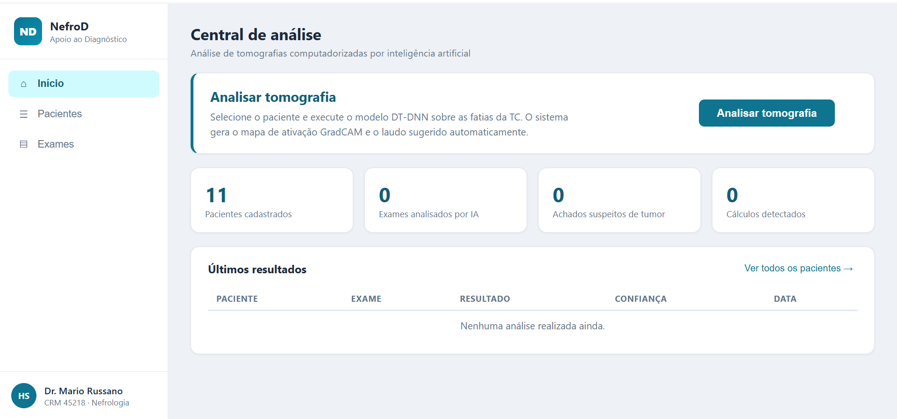
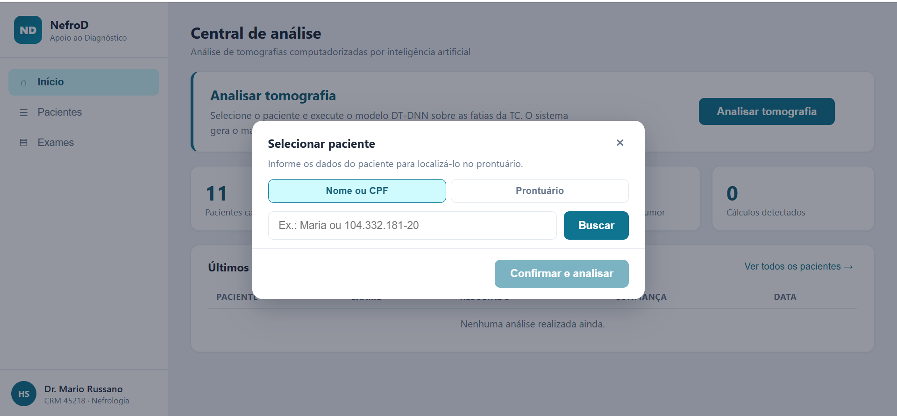
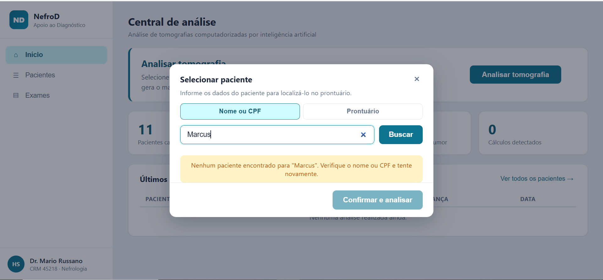
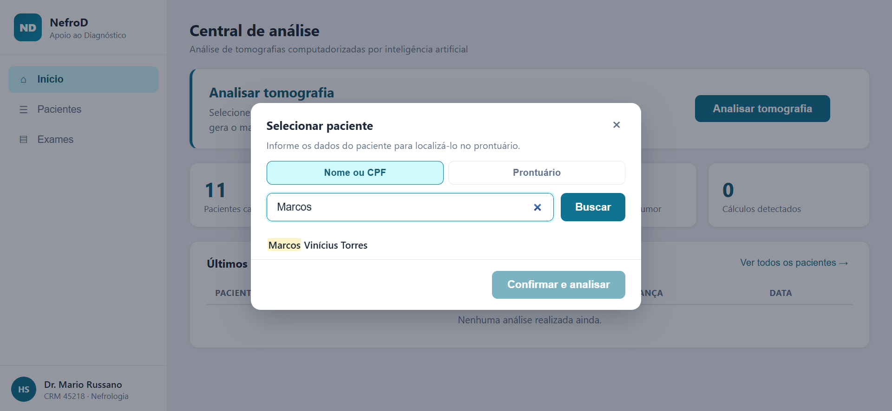
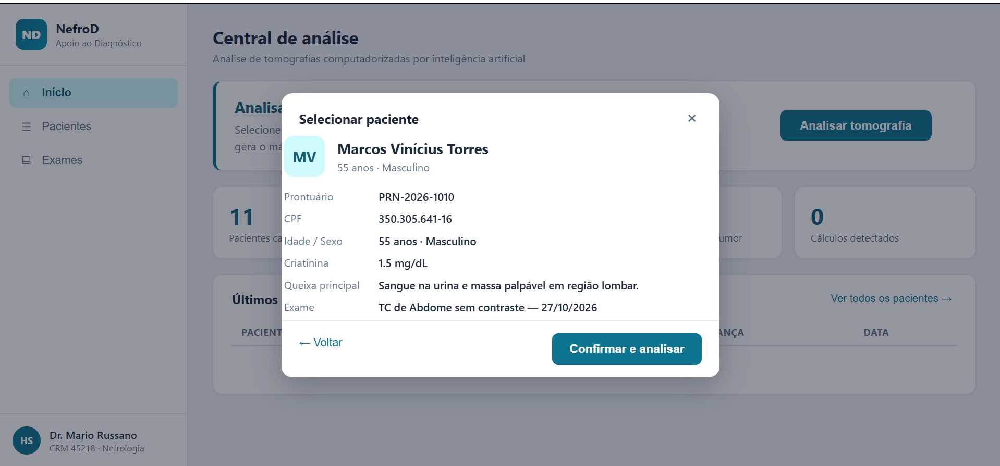
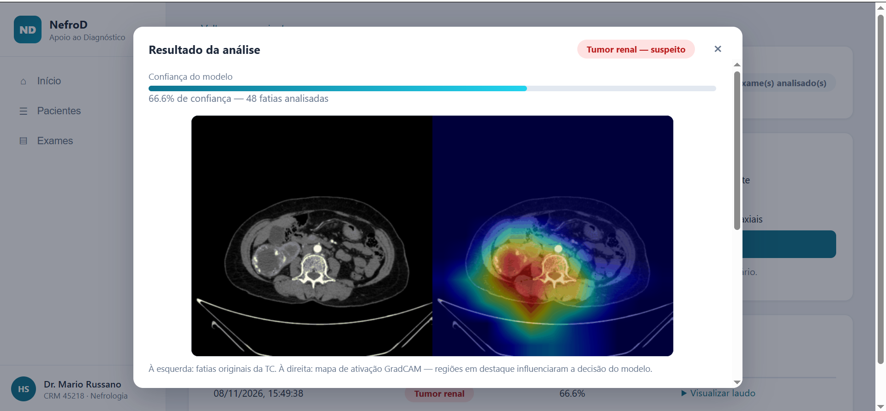
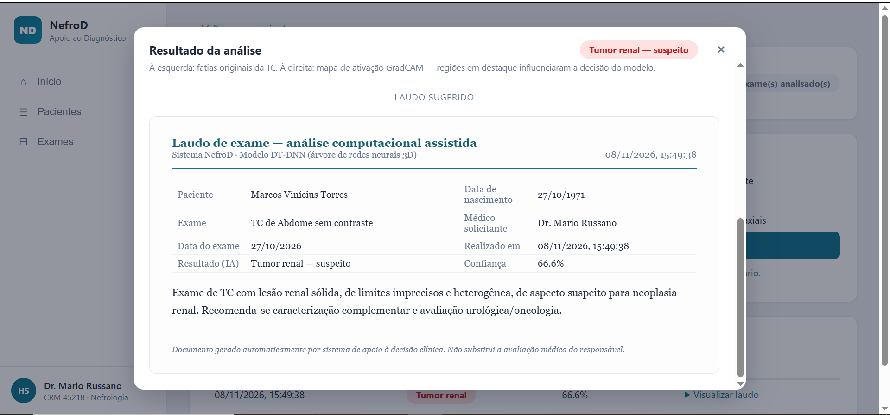

# Entrega 6 — Prototipação em papel

**Data:** 08/11/2026  
**Status:** 🟩 concluída  
**Responsabilidade:** 1 solução integrada por equipe

## Objetivo da atividade

Externalizar rapidamente ideias de interação em baixa fidelidade para explorar alternativas antes de investir em detalhes visuais. O valor da atividade está no **ciclo construir → simular → observar → revisar**, não na beleza do desenho.

## 1. Escopo do protótipo

**Personas:** P01  
**Cenários/tarefas cobertos:** C01/T01 
**Objetivos principais:** Avaliar tomografia

## 1.1 Possíveis famílias de interface

Escolha apenas o que for coerente com tarefas e cenários. Para TCCs técnicos, o protótipo pode explorar:

- **dashboard** para monitoramento e tomada de decisão;
- **configuração/parametrização** para preparar algoritmo/modelo/processo;
- **entrada/seleção de dados** com validação;
- **acompanhamento de execução** com progresso, fila, cancelamento e recuperação;
- **relatório/resultados** com explicação, gráficos e exportação;
- **histórico** com busca, filtros, ordenação e detalhes;
- **comparação** entre execuções, versões, algoritmos ou períodos;
- **administração** de usuários, papéis, permissões ou entidades do domínio;
- **auditoria/logs** traduzidos para o perfil;
- **alertas/ocorrências** com ação de resposta.

> Não desenhe todas essas telas por obrigação. O objetivo da baixa fidelidade é experimentar a **estrutura da interação** necessária para as tarefas priorizadas.

## 2. Fluxos escolhidos

| Fluxo | Tarefa/objetivo | Por que foi priorizado |
|---|---|---|
| PF01 | Avaliar tomografia | Fluxo compõe a tarefa principal. |

## 3. Telas e estados

- Numere as telas/estados (`P01`, `P02`...).
- Indique controles que mudam o estado.
- Mostre pelo menos caminhos principais e estados de erro/retorno relevantes.

### P01 - Tela inicial

- Controles que mudam o estado:
  - Botão "Analisar tomografia": redireciona para P2.

### P02 - Tela buscar paciente

- Controles que mudam o estado:
  - Botão "Buscar": ao confirmar a busca, gera estado de carregamento. Se o paciente existir, vai para P04; se não existir, vai para P03.

### P03 - Tela 'Paciente não encontrado'

- Controles que mudam o estado:
  - Botão "Buscar": ao confirmar a busca, gera estado de carregamento. Se o paciente existir, vai para P04; se não existir, se mantem em P03.

### P04 - Tela 'Paciente encontrado'

- Controles que mudam o estado:
  - Clicar no nome do paciente: habilita botão "Confirmar e analisar".
  - Botão "Confirmar e analisar": vai para P05.

### P05 - Tela informações paciente

- Controles que mudam o estado:
  - Botão "Confirmar e analisar": dispara o processamento e transfere para P06.
  - Botão "Voltar": retorna para P04 (tela de busca) para corrigir ou alterar a seleção.

### P06 - Tela resultado análise

- Controles que mudam o estado:
  - Botão "Fechar": retorna para P01.

## 4. Simulação / walkthrough

Realize uma simulação com uma pessoa que não participou da elaboração dessas telas. Um colega pode ser usado **para essa iteração formativa**, mas isso não substitui os participantes finais da Entrega 14.

| Observação | Tela/ação | Evidência | Consequência para o design |
|---|---|---|---|
| **visibilidade do status do sistema** - durante a análise não há indicador de progresso, spinner ou bloqueio da interface | Confirmação > processamento | Tela tem "delay" até resultado ser exibido | Adicionar indicador de progresso perceptível (spinner, skeleton no card de resultado ou overlay modal "Analisando…"). |
| **ajuda e documentação** - não há ajuda contextual ou texto explicando o que o modelo faz ou o que significam os rótulos de confiança; o disclaimer existe só no laudo | Card de resultado | Informação aparece apenas dentro do laudo; nada explica "confiança" ou o GradCAM para quem nunca usou | Adicionar microcopy no card de resultado (ex.: tooltip em "Confiança", legenda "vermelho = região que mais influenciou a decisão") - interpretabilidade sem explicação é ruído visual |

## 5. Alterações após a simulação

| Antes | Problema | Depois | Justificativa |
|---|---|---|---|
| Tela de confirmação sem feedback visual durante o processamento | O usuário não sabe se a análise está em andamento ou se o sistema está travado; isso gera dúvida e hesitação no momento crítico da tarefa | Adicionar informações de carregamento (ex: mensagem “Analisando tomografia…”) e bloqueio temporário de ações para deixar o status explícito | O feedback de progresso reduz incerteza, melhora a percepção de continuidade do sistema e evita que o usuário interprete a espera como falha. |
| Card de resultado com indicadores sem explicação contextual | O usuário não entende o que significa “confiança” e as regiões destacadas, especialmente sem experiência prévia com GradCAM; o texto no laudo é insuficiente e esconde a explicação. | Incluir informações no próprio card (ex: tooltips e legenda simples como “vermelho = área que mais influenciou a decisão”) | A interpretabilidade precisa ser compreendida no momento da leitura do resultado; explicações curtas e próximas aos elementos ajudam a transformar sinal visual em informação útil. |

## Checklist

- [x] O protótipo cobre tarefas relevantes da Entrega 5.
- [x] Cada tela/estado pode ser justificado por uma tarefa, decisão ou informação necessária.
- [x] O projeto não criou dashboard/CRUD/login apenas para parecer “completo”.
- [x] Telas/estados estão numerados e navegáveis na documentação.
- [x] Há pelo menos uma simulação/walkthrough documentado.
- [x] Críticas não foram apenas listadas: geraram decisão de revisão.
- [ ] O protótipo continua em baixa fidelidade; detalhes visuais não mascaram problemas de fluxo.
