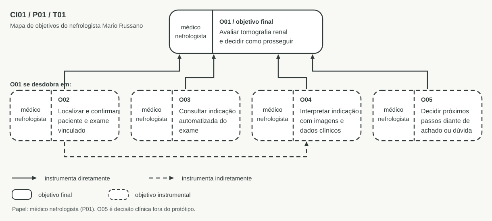

# Entrega 9 — Modelo conceitual e design centrado na comunicação

**Data:** 15/11/2026  
**Status:** 🟩 concluída  
**Responsabilidade:** soluções individuais, com consolidação da equipe para mapa de objetivos e esquema de signos.

## Objetivo da atividade

Passar do cenário de problema para uma concepção da interação, explicitando objetivos, tópicos de conversa, falas e signos que a interface deverá comunicar/manipular.

## Transformando resultados técnicos em conceitos compreensíveis

Em TCCs algorítmicos ou orientados a dados, esta entrega deve evitar que a interface exponha apenas estruturas internas do código. Identifique os **conceitos e signos que fazem sentido para o usuário**.

Exemplos:

- `query plan`, custo estimado, recomendação e impacto para um DBA;
- modelo, dataset, versão, execução e métrica para engenheiro de IA;
- período, indicador, grupo, tendência e filtro para gestor/analista;
- alerta, severidade, evidência, responsável e status para analista de segurança.

Se um termo técnico for necessário, modele como será comunicado, explicado e relacionado à tarefa.

Dashboards, relatórios, filtros e CRUDs devem aparecer no modelo conceitual por meio dos **objetivos, signos e conversas** que justificam sua existência.

## 1. Cenários de interação

Para cada cenário de problema, produza uma versão em que a solução já pode ser descrita. **Destaque claramente o texto alterado** em relação ao cenário original.

### CI01 — Dúvida na avaliação de possível alteração renal

**Autor(a):** Mariane S. Carvalho — RA: 22.123.105-3  
**Origem:** cenário problema C01 — Dúvida na avaliação de possível alteração renal

**Recorte:** proposta de interação para T01/P01 em um protótipo acadêmico, com caso fictício ou anonimizado. Os trechos marcados **[INTERAÇÃO — proposta]** acrescentam ações e respostas do sistema ao cenário refinado C01; as condições da rotina e as decisões clínicas continuam hipotéticas, sem validação com profissionais. A interface atual consulta exames previamente associados a pacientes em uma base local: não recebe pela interface a tomografia trazida pelo paciente, não se integra ao prontuário e não substitui a avaliação médica.

Durante uma consulta de acompanhamento na clínica de nefrologia, Mario Russano, médico nefrologista, recebe do paciente uma tomografia renal e seu relato sobre o histórico e a situação atual [Q1, Q2, Q3]. Em uma semana com vários exames a avaliar, por vezes mais de uma tomografia no mesmo período [Q11], ele precisa relacionar o exame ao caso antes de decidir como prosseguir. **[INTERAÇÃO — proposta]** Para consultar uma indicação automatizada em um caso de demonstração correspondente, Mario inicia a tarefa "Analisar tomografia"; o sistema abre a busca de pacientes da base local e esclarece que a análise só alcança os exames já vinculados a esses registros. O paciente fornece as informações; Mario continua responsável pela interpretação e por eventual contato com o radiologista ou outro profissional, fora do sistema [Q2, Q3].

**[INTERAÇÃO — proposta]** Mario busca o registro pelo nome/CPF ou número de prontuário, confere o paciente e os dados do exame associado antes de confirmar a análise [Q3, Q4]. O sistema apresenta os registros encontrados e o exame disponível para conferência; se não encontrar o paciente, informa a ausência de correspondência e permite corrigir a busca. Se os dados não corresponderem ao exame recebido ou não houver exame vinculado, Mario não inicia a análise: a interface deve informar que não há imagem elegível para esse caso, sem sugerir envio de arquivos ou apresentar resultado de outro paciente. O paciente não opera a interface nem valida a saída do modelo [Q2].

Mario consulta as imagens e o laudo disponíveis, percorre as fatias e compara estruturas renais, contornos, dimensões e regiões com aparência distinta; considera também o relato, o histórico e outras informações clínicas disponíveis [Q4, Q5, Q6]. **[INTERAÇÃO — proposta]** Após confirmar o caso correto, ele solicita a análise e recebe a mensagem "Analisando tomografia..." enquanto o sistema processa as imagens vinculadas; o comando fica indisponível para evitar solicitações duplicadas. Se o processamento falhar, o sistema informa que não há resultado, oferece nova tentativa e não apresenta a falha como ausência de alteração. Quando há resultado, apresenta a classe prevista, o percentual rotulado como confiança do modelo, a visualização das regiões destacadas e o texto sugerido, associados ao paciente/exame selecionado. Uma explicação junto ao resultado esclarece que a confiança é uma medida da saída do modelo, não certeza diagnóstica, e que o destaque visual mostra regiões que influenciaram a previsão, não confirma um achado clínico. Mario confronta essa indicação com as imagens, o laudo e o contexto clínico, sem tomar o texto sugerido como laudo definitivo [Q4, Q5, Q6].

Em uma região com aspecto diferente, Mario não consegue distinguir com segurança alteração relevante de variação sem significado clínico [Q7]. A qualidade limitada de parte das imagens e a ausência de informações sobre exames anteriores dificultam a comparação [Q8]. **[INTERAÇÃO — proposta]** Ele revê as fatias e o laudo; ao voltar ao resultado, o sistema mantém explícitos o exame consultado, a classe prevista e os limites da indicação, sem afirmar que a região destacada resolve a dúvida. Se o laudo ou o histórico clínico não estiverem disponíveis na base, a interface não os inventa: comunica a limitação e Mario consulta as fontes externas de que dispõe. Persistindo a dúvida, ele pode discutir o achado com o radiologista ou outro profissional envolvido; essa consulta não é apresentada como função implementada do protótipo [Q8, Q9].

Antes de decidir os próximos passos, Mario pondera achado, informações clínicas e incerteza [Q10]. **[INTERAÇÃO — proposta]** Ele encerra a consulta à indicação do modelo sabendo que o sistema registra a análise realizada no histórico local, mas **não** registra nem decide sua conclusão clínica. Se a dúvida não for esclarecida, Mario documenta por seus meios de trabalho que sua avaliação permanece inconclusiva e busca avaliação complementar apropriada ao caso, sem converter a previsão do modelo em diagnóstico [Q9, Q10]. Uma interpretação equivocada poderia levar a encaminhamentos ou investigações desnecessários; uma dúvida não resolvida poderia atrasar a continuidade da avaliação. Por isso, a interface distingue visual e textualmente resultado automatizado de decisão médica, e Mario evita tratar a impressão incerta como conclusão definitiva [Q12].

### Diferenças relevantes

| Alteração | Por que foi necessária | Evidência/artefato que justifica |
|---|---|---|
| Busca e confirmação do exame vinculado, com retorno para ausência ou divergência de registro | Evitar analisar um exame diferente do recebido pelo paciente, sem pressupor upload ou integração institucional | C01 [Q2, Q3, Q4]; Entregas 5 (T01) e 8 (capacidades e restrições) |
| Solicitação de análise com estado de espera, falha recuperável e resultado associado ao caso | Comunicar o andamento e distinguir ausência de resultado de ausência de alteração | C01 [Q4, Q7]; Entrega 6 (simulação e revisões); Entrega 8 (tempo de processamento) |
| Classe prevista, confiança, região destacada e texto sugerido com explicação de limites | Apoiar a inspeção das imagens sem apresentar a previsão como diagnóstico ou suprir informação clínica ausente | C01 [Q5, Q6, Q7, Q8]; Entrega 6 (ajuda contextual); Entrega 8 (metas de compreensão) |
| Revisão e decisão clínica fora do sistema, inclusive consulta profissional e avaliação complementar | Manter a responsabilidade de Mario e representar a incerteza sem inventar funções de comunicação ou registro clínico | C01 [Q2, Q9, Q10, Q12]; Entrega 8 (papéis e segurança de uso) |
| Busca em base local diante de vários exames, sem presumir escala validada | Situar a interação na rotina hipotética sem atribuir frequência medida ou capacidade de paginação ao protótipo | C01 [Q1, Q11]; Entrega 8 (volume de dados/histórico) |

## 2. Design centrado na comunicação

**Nome do cenário:** CI01 — Dúvida na avaliação de possível alteração renal (P01/T01)

**Objetivo da conversa:** consultar uma indicação automatizada para apoiar a avaliação de uma tomografia renal e decidir, sob responsabilidade de Mario, como prosseguir. As falas `D` descrevem a comunicação proposta para o protótipo; não pressupõem que todos os retornos já estejam implementados. O exame recebido do paciente, o laudo e os dados clínicos podem exigir consulta fora da interface.

| Tópico > subtópico | Falas e signos envolvidos | Intenção/efeito esperado |
|---|---|---|
| Avaliar tomografia renal com apoio do modelo | `U: Quero consultar uma indicação para este caso.` / `D: Posso analisar apenas exames previamente vinculados a registros desta base local; a indicação não é diagnóstico.` Signos: exame vinculado, indicação automatizada. | Delimitar o que o sistema oferece e manter a decisão clínica com o nefrologista. |
| > Localizar o caso | `U: Busco pelo nome/CPF ou número de prontuário.` / `D: Estes são os registros correspondentes.` Signos: critério de busca, paciente, prontuário, resultados da busca. | Encontrar o registro pertinente entre os casos disponíveis sem pressupor envio do exame recebido. |
| > Tratar busca sem correspondência | `U: Não encontrei o registro esperado.` / `D: Nenhum paciente encontrado; revise o critério e tente novamente.` Signos: critério de busca, ausência de resultados. | Evitar que ausência de cadastro seja interpretada como ausência de alteração renal e permitir corrigir a busca. |
| > Confirmar paciente e exame | `U: Este paciente e este exame correspondem ao caso que estou avaliando?` / `D: Confira os dados do paciente e o exame associado antes de analisar.` Signos: identificação do paciente, exame vinculado, confirmação. | Prevenir análise de exame incorreto; diante de divergência ou falta de imagem vinculada, não iniciar e comunicar a limitação. |
| > Iniciar e acompanhar a análise | `U: Confirmo o caso e solicito a análise.` / `D: Analisando tomografia... Aguarde o resultado.` Signos: exame confirmado, estado da análise. | Deixar perceptível o processamento e evitar solicitações duplicadas durante a espera. |
| > Recuperar falha de processamento | `U: A análise não retornou resultado; posso tentar novamente?` / `D: Não foi possível concluir a análise deste exame. Nenhum resultado está disponível; tente novamente.` Signos: falha, ausência de resultado, nova tentativa. | Distinguir falha técnica de uma indicação de normalidade e oferecer recuperação sem inventar resultado. |
| > Consultar a indicação | `U: O que o modelo indicou para este exame?` / `D: Classe prevista: [classe]; confiança do modelo: [percentual]. Veja a visualização associada e o texto sugerido; isto não é uma conclusão clínica.` Signos: classe prevista, confiança do modelo, visualização, texto sugerido. | Comunicar a saída vinculada ao exame certo como apoio, não como laudo definitivo. |
| > Entender a visualização e os limites | `U: O destaque confirma a região suspeita? O percentual indica certeza?` / `D: As regiões destacadas influenciaram a previsão; o percentual expressa confiança da saída do modelo. Nenhum dos dois confirma um achado clínico.` Signos: região destacada, classe prevista, confiança do modelo. | Evitar que explicação visual ou percentual sejam confundidos com prova diagnóstica. |
| > Confrontar com o contexto clínico | `U: Vou rever as fatias, o laudo, o relato e o histórico disponível.` / `D: Este resultado se refere ao exame selecionado; informações não disponíveis na base não foram consideradas nem preenchidas pelo sistema.` Signos: fatias, laudo, informações clínicas disponíveis, exame selecionado. | Apoiar a comparação sem ocultar limitações de imagem, laudo ou exames anteriores; Mario consulta fontes externas quando necessário. |
| > Prosseguir diante de dúvida | `U: A região continua inconclusiva; preciso discutir o caso ou buscar avaliação complementar.` / `D: A indicação automatizada não resolve a incerteza nem define o próximo passo clínico.` Signos: dúvida, indicação automatizada, avaliação complementar. | Preservar a possibilidade de revisão e consulta a outro profissional fora do protótipo, sem atribuir ao sistema uma decisão médica. |
| > Encerrar a consulta | `U: Encerro a consulta à indicação e registro minha avaliação pelos meios de trabalho apropriados.` / `D: A análise realizada consta no histórico local; sua conclusão clínica não foi registrada aqui.` Signos: histórico de análises, conclusão clínica. | Diferenciar o registro da execução do modelo da documentação e decisão do profissional. |

**Convenção:** `U` = usuário; `D` = preposto do designer/sistema, conforme a abordagem de Engenharia Semiótica adotada na disciplina.

## 3. Mapa de objetivos

**Escopo da consolidação:** há um cenário documentado (CI01), de P01/T01. O mapa reúne seus objetivos sem duplicar ações como "buscar por CPF" e "buscar por prontuário": ambas atendem a O02. Não há outros mapas individuais documentados para consolidar.

**Leitura do mapa:** comece por O01 no topo e leia seus objetivos instrumentais abaixo, da esquerda para a direita: localizar e confirmar o caso (O02), consultar a indicação (O03), interpretá-la com as imagens e informações clínicas (O04) e decidir como prosseguir (O05). As setas contínuas **partem de O02–O05 e apontam para O01**: cada objetivo instrumental o instrumenta diretamente. A seta tracejada de O02 para O04 indica que confirmar o caso também instrumenta indiretamente a interpretação. A direção das setas representa a relação de instrumentação, **não** a ordem de execução; Mario pode voltar à revisão. Cada nó separa o papel (médico nefrologista) do objetivo; O01 tem contorno contínuo (final) e O02–O05, tracejado (instrumentais). Não há papel alternativo configurável descrito para este cenário.

**Limite do apoio:** O02–O04 descrevem objetivos apoiados pela interação proposta. Em O05, o sistema apenas comunica os limites da indicação e o histórico da análise; Mario decide e documenta a conclusão clínica fora do protótipo. O mapa não prevê upload de exames, contato com radiologista pela interface ou diagnóstico automatizado.

### Dicionário de objetivos

| ID | Objetivo | Persona(s) | Cenário(s) | Prioridade |
|---|---|---|---|---|
| O01 | Avaliar tomografia renal e decidir como prosseguir | P01 | CI01 | Central — objetivo da tarefa T01 |
| O02 | Localizar e confirmar paciente e exame vinculado | P01 | CI01 | Alta — impede análise do caso errado |
| O03 | Consultar a indicação automatizada do exame | P01 | CI01 | Alta — inclui iniciar, acompanhar e recuperar falha da análise |
| O04 | Interpretar a indicação à luz das imagens e informações clínicas disponíveis | P01 | CI01 | Alta — distingue previsão, confiança e destaque visual de achado confirmado |
| O05 | Decidir os próximos passos diante de achado ou dúvida | P01 | CI01 | Alta — decisão clínica de Mario, apenas apoiada pela indicação |

## 4. Esquema conceitual de signos

Os signos abaixo correspondem à conversa de CI01 e aos objetivos O02–O05. **Origem** indica de onde vem a informação: usuário (Mario), sistema (interface/modelo) ou domínio (base local ou fontes externas). As mensagens de validação, ajuda e recuperação são **propostas de interação**, não capacidades já comprovadamente implementadas. Fontes externas constam para explicitar o que Mario considera, mas não são campos do protótipo. `—` significa que não há valor padrão ou mecanismo aplicável; ausência de informação não equivale a resultado normal.

| Grupo | Signo | Origem | Observações/semântica | Tipo de conteúdo | Restrição | Valor padrão | Prevenção | Recuperação |
|---|---|---|---|---|---|---|---|---|
| Localizar caso (O02) | critério de busca | usuário | Nome/CPF ou número de prontuário informado para localizar um registro; não é a identidade confirmada. | texto | Aceitar apenas os critérios oferecidos na busca; evitar exposição desnecessária de dados pessoais. | vazio | Indicar critérios aceitos e não iniciar análise a partir da digitação. | Corrigir o termo e repetir a busca. |
| Localizar caso (O02) | correspondência da busca | sistema | Registros encontrados ou mensagem explícita de nenhum paciente encontrado; ausência de correspondência não significa exame normal. | lista / mensagem | Vinculada ao critério consultado. | nenhuma busca realizada | Diferenciar lista vazia de falha de consulta. | Refazer a busca com outro critério. |
| Identificar caso (O02) | paciente | domínio (base local) | Registro selecionado; os dados de identificação servem para conferir o caso, não para confirmar achados. | identificação / registro | Não analisar sem seleção e conferência do paciente; usar apenas dados fictícios ou anonimizados no teste. | nenhum selecionado | Exibir dados suficientes para distinguir registros sem expor dados além do necessário. | Voltar à busca e selecionar o registro correto. |
| Identificar caso (O02) | exame vinculado | domínio (base local) | Imagens previamente associadas ao registro; não é upload da tomografia trazida pelo paciente. | referência ao exame / imagens | Deve existir e corresponder ao caso antes da análise. | nenhum selecionado | Apresentar o vínculo para conferência e impedir análise quando não houver imagem elegível. | Revisar paciente/exame na base; não atribuir exame de outro paciente. |
| Identificar caso (O02) | confirmação do caso | usuário | Ato de Mario confirmar a correspondência entre paciente e exame antes de solicitar a análise. | confirmação | Exige paciente e exame elegível; não confirma interpretação clínica. | não confirmado | Mostrar o caso escolhido antes de habilitar a análise. | Voltar e corrigir a seleção. |
| Analisar exame (O03) | estado da análise | sistema | Distingue pronto para iniciar, em processamento, resultado disponível e falha sem resultado. | estado / mensagem | Resultado só é apresentado se o processamento concluir; falha não equivale a ausência de alteração. | pronto para iniciar após confirmação | Mostrar mensagem de espera e impedir solicitações duplicadas. | Em falha, informar ausência de resultado e oferecer nova tentativa. |
| Analisar exame (O03) | histórico de análises | sistema (registro local) | Guarda análises realizadas do caso; não contém a conclusão clínica de Mario. | lista de execuções | Cada entrada deve permanecer associada ao paciente/exame analisado. | sem análises para o caso | Separar registro de execução de decisão médica. | Reabrir a análise correta ou voltar ao caso; não inferir decisão de registro ausente. |
| Interpretar resultado (O04) | imagens da tomografia | domínio (base local e exame recebido) | Fatias que Mario examina e compara; não pressupõe visualizador completo ou importação do exame recebido pela interface. | imagens | Disponibilidade e qualidade podem limitar a comparação. | somente imagens disponíveis | Indicar quando imagens vinculadas não estiverem disponíveis. | Consultar o exame por seus meios de trabalho; não analisar caso sem imagens vinculadas. |
| Interpretar resultado (O04) | laudo original | domínio (fonte externa) | Documento do exame consultado por Mario; distinto do texto sugerido pelo modelo. | texto / documento | Pode não estar na base local. | não disponível na interface | Não apresentar texto sugerido como se fosse laudo original. | Consultar o documento na fonte em que foi recebido. |
| Interpretar resultado (O04) | informações clínicas disponíveis | domínio (relato e fontes externas) | Histórico e situação atual relatados pelo paciente, além de exames anteriores quando houver; não são inferidos das imagens. | relato / documentos | Podem estar incompletos ou ausentes da base local. | não preenchidas na interface | Explicitar que a saída do modelo não incorpora dados clínicos não fornecidos. | Mario consulta fontes externas ou busca avaliação complementar, conforme o caso. |
| Interpretar resultado (O04) | classe prevista | sistema (modelo) | Indicação automatizada para o exame selecionado, não diagnóstico confirmado. | categoria / texto | Mostrar apenas com resultado concluído e contexto do exame. | sem resultado | Rotular como previsão e associar ao caso confirmado. | Rever imagens/laudo e não usar a previsão isoladamente se houver divergência. |
| Interpretar resultado (O04) | confiança do modelo | sistema (modelo) | Percentual associado à classe prevista; não expressa certeza clínica nem valida o achado. | percentual | De 0% a 100%; exibido apenas quando há resultado. | sem resultado | Explicar seu significado junto ao percentual, sem tratá-lo como probabilidade diagnóstica validada. | Consultar a explicação e confrontar a previsão com o contexto disponível. |
| Interpretar resultado (O04) | região destacada | sistema (visualização do modelo) | Área que influenciou a previsão na imagem; não comprova localização de lesão. | imagem / destaque visual | Vinculada à análise correspondente; pode não estar disponível em falha. | sem visualização | Oferecer legenda textual e não depender apenas de cor. | Rever imagem e laudo originais; se indisponível, não inferir ausência de achado. |
| Interpretar resultado (O04) | texto sugerido | sistema (textos por classe) | Texto montado conforme a classe prevista; não é laudo individualizado nem conclusão médica. | texto | Disponível apenas com resultado; não substitui avaliação de Mario. | sem texto | Identificar como sugestão automatizada separada do laudo original. | Desconsiderar o texto quando divergir do exame e registrar avaliação por meios próprios. |
| Prosseguir (O05) | avaliação inconclusiva | usuário (Mario, fora da interface) | Dúvida que permanece após revisar exame, laudo, contexto e indicação. | juízo profissional | Não há campo ou registro clínico dessa avaliação no protótipo. | — | Comunicar limites da previsão sem sugerir certeza diante de dúvida. | Mario documenta a incerteza por seus meios de trabalho e consulta outro profissional se necessário. |
| Prosseguir (O05) | próximos passos clínicos | usuário (Mario, fora da interface) | Decisão de continuar a avaliação, discuti-la ou buscar avaliação complementar conforme o caso. | decisão profissional | Não é gerada, recomendada nem registrada como conclusão clínica pelo protótipo. | — | Separar visual e textualmente indicação automatizada de decisão médica. | Rever dados disponíveis e procurar avaliação complementar sem converter previsão em diagnóstico. |

### Regras para os signos

- Use o vocabulário do domínio do usuário.
- Evite duplicar o mesmo conceito com nomes diferentes.
- Diferencie informação fornecida pelo usuário, produzida pelo sistema e derivada do domínio.
- Registre prevenção e recuperação apenas quando fizer sentido; explique as siglas usadas.

## Síntese

O MoLIC de **CI01/T01** deve começar com **O01 — Avaliar tomografia renal e decidir como prosseguir**, desdobrado em conversas que apoiam O02–O05. Os tópicos e signos indispensáveis são:

- **O02 — Localizar e confirmar paciente e exame vinculado:** conversar sobre critério de busca, correspondência da busca, paciente, exame vinculado e confirmação do caso. Prever busca sem resultado, registro divergente ou exame ausente, com correção/retorno antes de analisar.
- **O03 — Consultar a indicação automatizada:** Mario solicita a análise do exame confirmado; o sistema comunica o estado da análise (espera, resultado ou falha). Prever nova tentativa após falha, sem confundir ausência de resultado com exame normal.
- **O04 — Interpretar a indicação:** comunicar classe prevista, confiança do modelo, região destacada e texto sugerido com seus limites; Mario os confronta com imagens da tomografia, laudo original e informações clínicas disponíveis, inclusive quando estas só existem fora da interface. Prever revisão diante de divergência ou informação ausente.
- **O05 — Decidir os próximos passos:** diante de avaliação inconclusiva, Mario pode rever o caso ou encerrar a consulta à indicação e buscar avaliação complementar por seus meios de trabalho. O sistema pode comunicar o histórico de análises, mas não registra nem determina os próximos passos clínicos.

Essas conversas devem distinguir resultado automatizado, laudo original e conclusão clínica; representar feedback e recuperação das rupturas sem modelar upload, contato com radiologista ou decisão médica como funções do protótipo.

## Checklist

- [x] Cenários de interação mostram alterações em relação aos cenários de problema.
- [x] Cada solução individual identifica autor e cenário de origem.
- [x] Tópicos/falas/signos são coerentes com objetivos do usuário.
- [x] Mapas individuais foram consolidados.
- [x] O esquema de signos está em uma tabela única e sem duplicações conceituais.
- [x] Nomes de objetivos/signos serão reutilizados na Entrega 10.
- [x] Em TCC técnico, signos representam conceitos do domínio compreensíveis ao usuário, não apenas variáveis/estruturas internas.
- [x] Padrões como dashboard, relatório, filtros, administração e CRUD possuem objetivos e signos correspondentes.
- [x] A interface comunica não só o resultado técnico, mas também seu significado para a tarefa.
