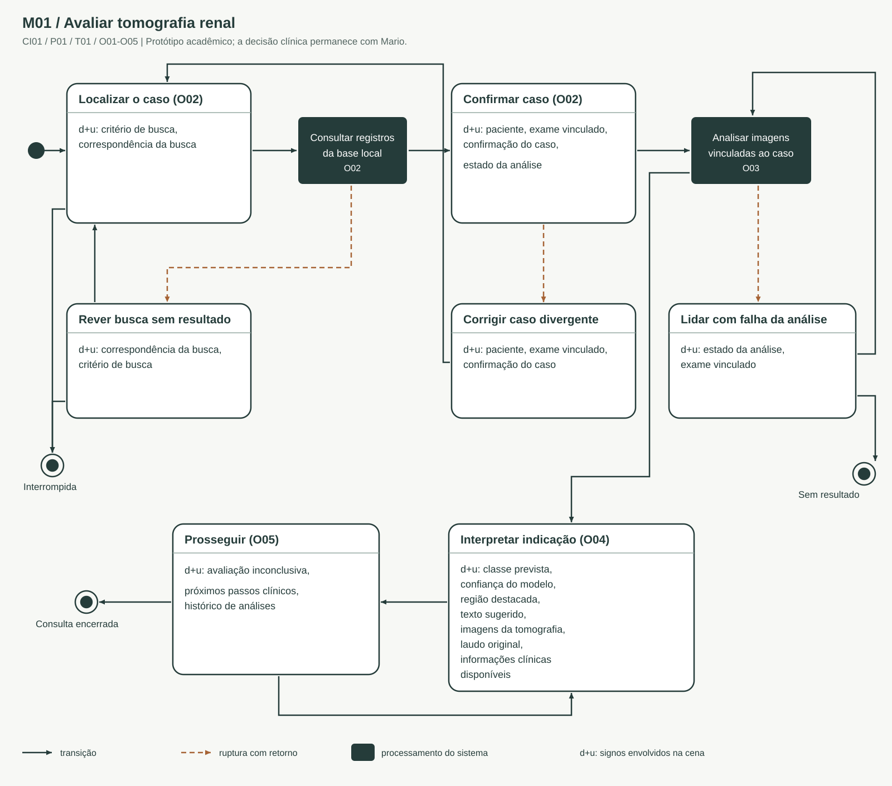

# Entrega 10 — MoLIC

**Data:** 15/11/2026  
**Status:** 🟩 concluída

**Responsabilidade:** 1 solução completa por integrante

## Objetivo da atividade

Modelar a interação como uma **conversa entre usuário e preposto do designer**, oferecendo visão global dos caminhos que permitem ao usuário atingir seus objetivos — incluindo alternativas e rupturas relevantes. MoLIC não deve ser reduzida a um fluxograma de telas.

> Use a **notação MoLIC ensinada na disciplina**. Este template foca critérios de qualidade e não substitui a legenda/notação apresentada em aula.

## Atenção a TCCs sem interface original

O MoLIC não modela o algoritmo por dentro. Ele modela a **conversa de interação necessária para que uma pessoa use a contribuição**.

Exemplos de conversas:

- usuário escolhe dados/parâmetros → sistema valida → usuário inicia análise → sistema comunica processamento → usuário interpreta resultado;
- usuário consulta histórico → refina filtros → abre execução → compara com outra;
- administrador seleciona perfil → altera permissão → sistema comunica consequências → administrador confirma/cancela;
- analista recebe alerta → examina evidências → classifica ocorrência → registra decisão.

Modele também rupturas plausíveis: entrada inválida, falha de processamento, ausência de resultado, permissão insuficiente, filtro sem resultados, conflito de alteração, cancelamento ou necessidade de recuperação.

## M01 — Avaliar tomografia renal e decidir como prosseguir

**Autor(a):** Mariane S. Carvalho — RA: 22.123.105-3  
**Cenário de interação de origem:** CI01 — Dúvida na avaliação de possível alteração renal

**Objetivo(s):** O01 (objetivo final); O02–O05 (instrumentais)

**Tarefa(s) relacionada(s):** T01 — Avaliar tomografia

**Signos relevantes:** critério de busca, correspondência da busca, paciente, exame vinculado, confirmação do caso, estado da análise, classe prevista, confiança do modelo, região destacada, texto sugerido, imagens da tomografia, laudo original, informações clínicas disponíveis, histórico de análises, avaliação inconclusiva e próximos passos clínicos.

### Diagrama

**Fonte editável:** [molic_m01.svg](../assets/10_molic/molic_m01.svg) (texto e formas vetoriais editáveis).

**Notação:** seguindo a leitura de MoLIC em Barbosa e Silva (2010), o círculo preenchido abre a interação; os retângulos arredondados representam **cenas** com tópicos e signos envolvidos, identificados por `d+u: <lista de signos>` (preposto do designer e usuário); as setas representam transições entre cenas; as caixas preenchidas indicam **processamentos do sistema**; os círculos duplos encerram a interação. As transições em laranja tracejado destacam rupturas e apontam para cenas de recuperação; não representam uma etapa do algoritmo. **O diagrama não transcreve falas nem rotula transições com frases**: as ações, os feedbacks e as condições de cada caminho são explicados na leitura textual a seguir.

**Escopo:** modelo proposto para caso fictício ou anonimizado na base local. As mensagens de ausência de exame, ajuda contextual e recuperação descrevem a interação desejada, não comprovam implementação. O exame recebido do paciente e as informações clínicas externas não são carregados na interface; não se modelam login, upload, comunicação com radiologista ou conclusão clínica automatizada.

### Leitura do diagrama

As cenas representam assuntos da conversa, não nomes de telas. O processamento da busca e o da análise são opacos para Mario; ele recebe retorno sobre resultados, espera ou falha, sem precisar conhecer o funcionamento interno do modelo.

#### Caminho principal

1. Do ponto de abertura, Mario comunica que deseja analisar uma tomografia e entra na cena **Localizar o caso (O02)**. O preposto esclarece que só há exames vinculados à base local; Mario informa nome/CPF ou prontuário. Após o processamento **Consultar registros da base local**, o preposto apresenta os registros encontrados.
2. Na cena **Conferir paciente e exame (O02)**, Mario verifica a correspondência do paciente e do exame vinculado. Ao confirmar e pedir a análise, o preposto comunica "Analisando tomografia..." durante o processamento **Analisar imagens vinculadas ao caso (O03)**, evitando pedidos duplicados.
3. Com resultado disponível, a cena **Interpretar indicação (O04)** comunica classe prevista, confiança do modelo, região destacada e texto sugerido, com seus limites. Mario compara a indicação com as imagens, o laudo e as informações clínicas disponíveis por seus próprios meios; o sistema não supre dados externos ausentes.
4. Na cena **Prosseguir diante da dúvida (O05)**, Mario pode voltar à indicação para revê-la ou encerrar a consulta. O preposto comunica que o histórico local registra a análise, não a conclusão clínica. Mario decide os próximos passos fora do protótipo e chega ao ponto de encerramento **Consulta encerrada**.

#### Alternativas e rupturas

| Situação | Onde ocorre | Como o usuário percebe | Caminho de recuperação/saída |
|---|---|---|---|
| Busca sem correspondência | Após consultar a base local | `D: Nenhum paciente encontrado.` | Cena **Rever busca sem resultado**; `U: corrigir o critério` retorna a **Localizar o caso**, ou encerra sem analisar. |
| Dados divergentes ou exame não vinculado | Conferir paciente e exame | Mario percebe a divergência; se faltar imagem na base, `D: Não há imagem vinculada.` | Cena **Corrigir caso divergente**; voltar à busca para selecionar outro registro, sem processar exame de outro paciente. |
| Falha de processamento | Analisar imagens vinculadas ao caso | `D: Não houve resultado.` A falha não comunica normalidade. | Cena **Lidar com falha da análise**; tentar novamente ou encerrar no ponto **Sem resultado**. |
| Laudo ou informações clínicas ausentes da base | Interpretar indicação | `D: Dados externos não são inferidos.` | Mario consulta fontes externas disponíveis ou prossegue reconhecendo a limitação; o protótipo não inventa esses dados. |
| Indicação divergente ou dúvida persistente | Prosseguir diante da dúvida | `D: O histórico registra a análise, não a conclusão clínica.` | Voltar a **Interpretar indicação** para revisar; se a dúvida permanecer, encerrar e buscar avaliação complementar fora do sistema. |
| Desistência antes de analisar | Localizar o caso ou rever busca sem resultado | Mario escolhe encerrar sem obter indicação. | Ponto de encerramento **Interrompida**, distinto de consulta concluída com resultado. |

### Checklist específico de modelagem

- [x] Existe **ponto de abertura** coerente com o início do objetivo.
- [x] As **cenas de conversa** representam tópicos/assuntos, não nomes de páginas apenas.
- [x] As cenas identificam os signos `d+u`; as transições e seus feedbacks são explicados na leitura textual.
- [x] Há **ponto(s) de encerramento** para objetivos concluídos/abandonados quando aplicável.
- [x] Processamentos do sistema são caixas próprias, sem “inventar” falas do usuário.
- [x] Rupturas relevantes têm feedback e caminho de recuperação ou saída.
- [x] Não foram criados acessos ubíquos/atalhos sem necessidade.
- [x] O diagrama cobre caminhos alternativos importantes, não apenas o caminho principal.
- [x] Nomes de objetivos, tópicos e signos são coerentes com a Entrega 9.
- [x] O SVG tem texto vetorial e fonte editável; verificar a legibilidade no tamanho de exibição usado na entrega.
- [x] O MoLIC representa a conversa usuário–sistema, não o fluxo interno do algoritmo.
- [x] Processamento e histórico local têm retornos/rupturas; filtros, administração e relatórios não integram CI01.

> Repita M02, M03... para todos os integrantes.

## Consolidação da equipe

### Cobertura dos objetivos

| Objetivo | MoLIC que cobre | Lacunas/duplicidades | Decisão |
|---|---|---|---|
| O01 | M01 | Objetivo final de CI01; sem outros cenários documentados para comparar. | Coberto pelas cenas de O02–O05 e pelos encerramentos. |
| O02 | M01 | Busca, confirmação e correção de caso. | Reutilizar "paciente" e "exame vinculado" da Entrega 9. |
| O03 | M01 | Espera, resultado e falha da análise. | Distinguir falha de ausência de alteração. |
| O04 | M01 | Interpretação da indicação com fontes clínicas externas. | Comunicar limites da classe, confiança, destaque e texto sugerido. |
| O05 | M01 | Próximos passos fora do sistema. | Não adicionar registro de decisão clínica ao protótipo. |

### Preparação para o Figma

Para uma futura prototipação visual, as conversas de M01 pedem estados de busca (inicial, resultados, nenhum encontrado), conferência do paciente/exame (correto, divergente ou ausente), análise em andamento, falha com nova tentativa, resultado com explicação dos limites e encerramento. A revisão deve permitir retornar à indicação; o histórico local registra a análise. Esses estados não implicam upload de arquivos, laudo original integrado ou registro de decisão clínica.

## Erros frequentes a evitar

- desenhar apenas caixas com nomes de telas e setas de navegação;
- não modelar falhas, cancelamento, volta ou recuperação;
- usar rótulos genéricos (“Tela 1”, “Processo 2”) sem tópico de conversa;
- criar no Figma fluxos que não existem no MoLIC;
- diagrama sem legenda/fonte editável e com texto ilegível.
